<!-- GENERATED by scripts/docs/gen_schema.py from schema/*.sql — do not edit. Regenerate with `just docs-gen`. -->

### Sequences, commit log, metadata

From `schema/001_meta.sql`: `commit`, `entity_metadata`, `erasure_marker`, `metadata`, `parameter_value_metadata`.

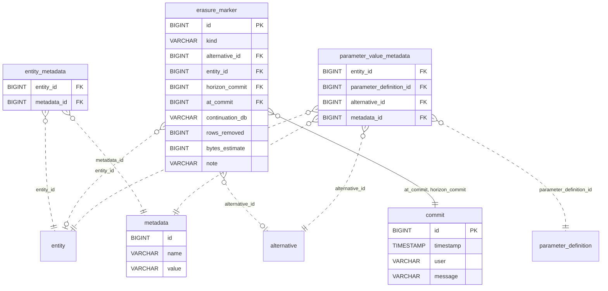

??? info "Columns: commit, entity_metadata, erasure_marker, metadata, parameter_value_metadata"

    | Table | Column | Type | Null | Key |
    | --- | --- | --- | --- | --- |
    | `commit` | `id` | `BIGINT` |  | PK |
    | `commit` | `timestamp` | `TIMESTAMP` |  |  |
    | `commit` | `user` | `VARCHAR` |  |  |
    | `commit` | `message` | `VARCHAR` | yes |  |
    | `entity_metadata` | `entity_id` | `BIGINT` |  | FK |
    | `entity_metadata` | `metadata_id` | `BIGINT` |  | FK |
    | `entity_metadata` | `valid_from_commit` | `BIGINT` |  | FK |
    | `entity_metadata` | `valid_to_commit` | `BIGINT` | yes | FK |
    | `entity_metadata` | `version` | `SMALLINT` |  |  |
    | `erasure_marker` | `id` | `BIGINT` |  | PK |
    | `erasure_marker` | `kind` | `VARCHAR` |  |  |
    | `erasure_marker` | `alternative_id` | `BIGINT` | yes | FK |
    | `erasure_marker` | `entity_id` | `BIGINT` | yes | FK |
    | `erasure_marker` | `horizon_commit` | `BIGINT` | yes | FK |
    | `erasure_marker` | `at_commit` | `BIGINT` |  | FK |
    | `erasure_marker` | `continuation_db` | `VARCHAR` | yes |  |
    | `erasure_marker` | `rows_removed` | `BIGINT` |  |  |
    | `erasure_marker` | `bytes_estimate` | `BIGINT` | yes |  |
    | `erasure_marker` | `note` | `VARCHAR` | yes |  |
    | `metadata` | `id` | `BIGINT` |  |  |
    | `metadata` | `name` | `VARCHAR` |  |  |
    | `metadata` | `value` | `VARCHAR` |  |  |
    | `metadata` | `valid_from_commit` | `BIGINT` |  | FK |
    | `metadata` | `valid_to_commit` | `BIGINT` | yes | FK |
    | `metadata` | `version` | `SMALLINT` |  |  |
    | `parameter_value_metadata` | `entity_id` | `BIGINT` |  | FK |
    | `parameter_value_metadata` | `parameter_definition_id` | `BIGINT` |  | FK |
    | `parameter_value_metadata` | `alternative_id` | `BIGINT` |  | FK |
    | `parameter_value_metadata` | `metadata_id` | `BIGINT` |  | FK |
    | `parameter_value_metadata` | `valid_from_commit` | `BIGINT` |  | FK |
    | `parameter_value_metadata` | `valid_to_commit` | `BIGINT` | yes | FK |
    | `parameter_value_metadata` | `version` | `SMALLINT` |  |  |

### Entity classes, class-sets, dimensions, entities, elements, locations

From `schema/010_entities.sql`: `class_set`, `class_set_member`, `entity`, `entity_class`, `entity_class_dimension`, `entity_element`, `entity_location`.

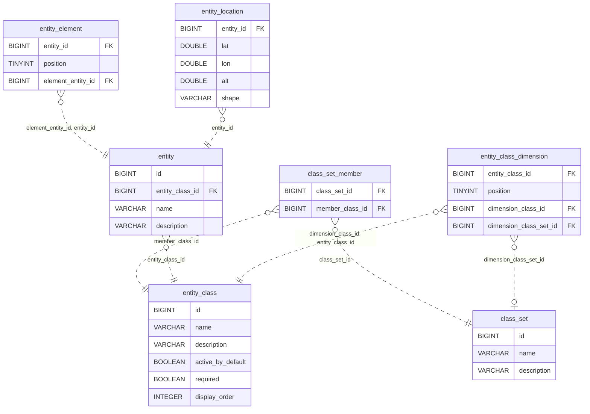

??? info "Columns: class_set, class_set_member, entity, entity_class, entity_class_dimension, entity_element, entity_location"

    | Table | Column | Type | Null | Key |
    | --- | --- | --- | --- | --- |
    | `class_set` | `id` | `BIGINT` |  |  |
    | `class_set` | `name` | `VARCHAR` |  |  |
    | `class_set` | `description` | `VARCHAR` | yes |  |
    | `class_set` | `valid_from_commit` | `BIGINT` |  | FK |
    | `class_set` | `valid_to_commit` | `BIGINT` | yes | FK |
    | `class_set` | `version` | `SMALLINT` |  |  |
    | `class_set_member` | `class_set_id` | `BIGINT` |  | FK |
    | `class_set_member` | `member_class_id` | `BIGINT` |  | FK |
    | `class_set_member` | `valid_from_commit` | `BIGINT` |  | FK |
    | `class_set_member` | `valid_to_commit` | `BIGINT` | yes | FK |
    | `class_set_member` | `version` | `SMALLINT` |  |  |
    | `entity` | `id` | `BIGINT` |  |  |
    | `entity` | `entity_class_id` | `BIGINT` |  | FK |
    | `entity` | `name` | `VARCHAR` |  |  |
    | `entity` | `description` | `VARCHAR` | yes |  |
    | `entity` | `valid_from_commit` | `BIGINT` |  | FK |
    | `entity` | `valid_to_commit` | `BIGINT` | yes | FK |
    | `entity` | `version` | `SMALLINT` |  |  |
    | `entity_class` | `id` | `BIGINT` |  |  |
    | `entity_class` | `name` | `VARCHAR` |  |  |
    | `entity_class` | `description` | `VARCHAR` | yes |  |
    | `entity_class` | `active_by_default` | `BOOLEAN` |  |  |
    | `entity_class` | `required` | `BOOLEAN` |  |  |
    | `entity_class` | `display_order` | `INTEGER` | yes |  |
    | `entity_class` | `valid_from_commit` | `BIGINT` |  | FK |
    | `entity_class` | `valid_to_commit` | `BIGINT` | yes | FK |
    | `entity_class` | `version` | `SMALLINT` |  |  |
    | `entity_class_dimension` | `entity_class_id` | `BIGINT` |  | FK |
    | `entity_class_dimension` | `position` | `TINYINT` |  |  |
    | `entity_class_dimension` | `dimension_class_id` | `BIGINT` | yes | FK |
    | `entity_class_dimension` | `dimension_class_set_id` | `BIGINT` | yes | FK |
    | `entity_class_dimension` | `valid_from_commit` | `BIGINT` |  | FK |
    | `entity_class_dimension` | `valid_to_commit` | `BIGINT` | yes | FK |
    | `entity_class_dimension` | `version` | `SMALLINT` |  |  |
    | `entity_element` | `entity_id` | `BIGINT` |  | FK |
    | `entity_element` | `position` | `TINYINT` |  |  |
    | `entity_element` | `element_entity_id` | `BIGINT` |  | FK |
    | `entity_element` | `valid_from_commit` | `BIGINT` |  | FK |
    | `entity_element` | `valid_to_commit` | `BIGINT` | yes | FK |
    | `entity_element` | `version` | `SMALLINT` |  |  |
    | `entity_location` | `entity_id` | `BIGINT` |  | FK |
    | `entity_location` | `lat` | `DOUBLE` | yes |  |
    | `entity_location` | `lon` | `DOUBLE` | yes |  |
    | `entity_location` | `alt` | `DOUBLE` | yes |  |
    | `entity_location` | `shape` | `VARCHAR` | yes |  |
    | `entity_location` | `valid_from_commit` | `BIGINT` |  | FK |
    | `entity_location` | `valid_to_commit` | `BIGINT` | yes | FK |
    | `entity_location` | `version` | `SMALLINT` |  |  |

### Alternatives, scenarios, entity activation, and the generalized group-membership relation

From `schema/020_alternatives.sql`: `alternative`, `entity_alternative`, `membership`, `scenario`, `scenario_alternative`.

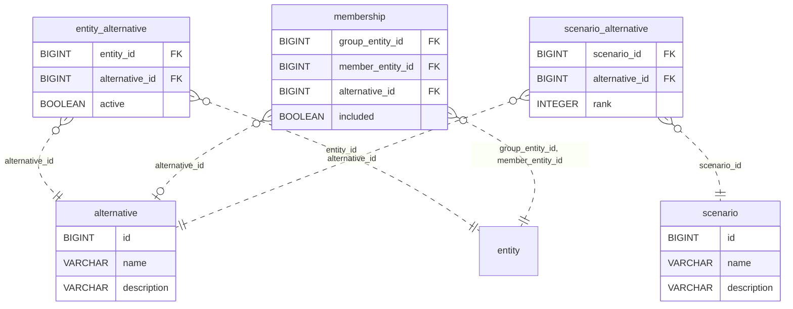

??? info "Columns: alternative, entity_alternative, membership, scenario, scenario_alternative"

    | Table | Column | Type | Null | Key |
    | --- | --- | --- | --- | --- |
    | `alternative` | `id` | `BIGINT` |  |  |
    | `alternative` | `name` | `VARCHAR` |  |  |
    | `alternative` | `description` | `VARCHAR` | yes |  |
    | `alternative` | `valid_from_commit` | `BIGINT` |  | FK |
    | `alternative` | `valid_to_commit` | `BIGINT` | yes | FK |
    | `alternative` | `version` | `SMALLINT` |  |  |
    | `entity_alternative` | `entity_id` | `BIGINT` |  | FK |
    | `entity_alternative` | `alternative_id` | `BIGINT` |  | FK |
    | `entity_alternative` | `active` | `BOOLEAN` |  |  |
    | `entity_alternative` | `valid_from_commit` | `BIGINT` |  | FK |
    | `entity_alternative` | `valid_to_commit` | `BIGINT` | yes | FK |
    | `entity_alternative` | `version` | `SMALLINT` |  |  |
    | `membership` | `group_entity_id` | `BIGINT` |  | FK |
    | `membership` | `member_entity_id` | `BIGINT` |  | FK |
    | `membership` | `alternative_id` | `BIGINT` | yes | FK |
    | `membership` | `included` | `BOOLEAN` |  |  |
    | `membership` | `valid_from_commit` | `BIGINT` |  | FK |
    | `membership` | `valid_to_commit` | `BIGINT` | yes | FK |
    | `membership` | `version` | `SMALLINT` |  |  |
    | `scenario` | `id` | `BIGINT` |  |  |
    | `scenario` | `name` | `VARCHAR` |  |  |
    | `scenario` | `description` | `VARCHAR` | yes |  |
    | `scenario` | `valid_from_commit` | `BIGINT` |  | FK |
    | `scenario` | `valid_to_commit` | `BIGINT` | yes | FK |
    | `scenario` | `version` | `SMALLINT` |  |  |
    | `scenario_alternative` | `scenario_id` | `BIGINT` |  | FK |
    | `scenario_alternative` | `alternative_id` | `BIGINT` |  | FK |
    | `scenario_alternative` | `rank` | `INTEGER` |  |  |
    | `scenario_alternative` | `valid_from_commit` | `BIGINT` |  | FK |
    | `scenario_alternative` | `valid_to_commit` | `BIGINT` | yes | FK |
    | `scenario_alternative` | `version` | `SMALLINT` |  |  |

### Units registry, value lists, parameter definitions, per-entity unit override, and structural type declarations

From `schema/030_parameters.sql`: `entity_parameter_unit`, `list_value`, `parameter_definition`, `parameter_type`, `parameter_type_dimension`, `parameter_value_list`, `units_of_measure`.

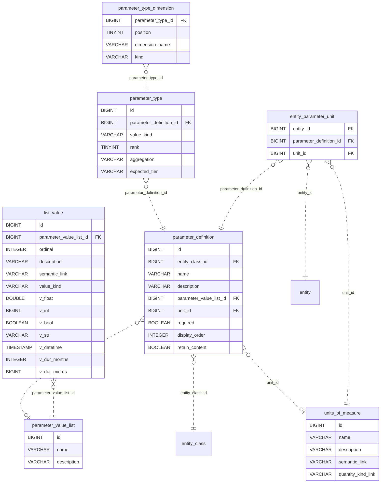

??? info "Columns: entity_parameter_unit, list_value, parameter_definition, parameter_type, parameter_type_dimension, parameter_value_list, units_of_measure"

    | Table | Column | Type | Null | Key |
    | --- | --- | --- | --- | --- |
    | `entity_parameter_unit` | `entity_id` | `BIGINT` |  | FK |
    | `entity_parameter_unit` | `parameter_definition_id` | `BIGINT` |  | FK |
    | `entity_parameter_unit` | `unit_id` | `BIGINT` |  | FK |
    | `entity_parameter_unit` | `valid_from_commit` | `BIGINT` |  | FK |
    | `entity_parameter_unit` | `valid_to_commit` | `BIGINT` | yes | FK |
    | `entity_parameter_unit` | `version` | `SMALLINT` |  |  |
    | `list_value` | `id` | `BIGINT` |  |  |
    | `list_value` | `parameter_value_list_id` | `BIGINT` |  | FK |
    | `list_value` | `ordinal` | `INTEGER` |  |  |
    | `list_value` | `description` | `VARCHAR` | yes |  |
    | `list_value` | `semantic_link` | `VARCHAR` | yes |  |
    | `list_value` | `value_kind` | `VARCHAR` |  |  |
    | `list_value` | `v_float` | `DOUBLE` | yes |  |
    | `list_value` | `v_int` | `BIGINT` | yes |  |
    | `list_value` | `v_bool` | `BOOLEAN` | yes |  |
    | `list_value` | `v_str` | `VARCHAR` | yes |  |
    | `list_value` | `v_datetime` | `TIMESTAMP` | yes |  |
    | `list_value` | `v_dur_months` | `INTEGER` | yes |  |
    | `list_value` | `v_dur_micros` | `BIGINT` | yes |  |
    | `list_value` | `valid_from_commit` | `BIGINT` |  | FK |
    | `list_value` | `valid_to_commit` | `BIGINT` | yes | FK |
    | `list_value` | `version` | `SMALLINT` |  |  |
    | `parameter_definition` | `id` | `BIGINT` |  |  |
    | `parameter_definition` | `entity_class_id` | `BIGINT` |  | FK |
    | `parameter_definition` | `name` | `VARCHAR` |  |  |
    | `parameter_definition` | `description` | `VARCHAR` | yes |  |
    | `parameter_definition` | `parameter_value_list_id` | `BIGINT` | yes | FK |
    | `parameter_definition` | `unit_id` | `BIGINT` | yes | FK |
    | `parameter_definition` | `required` | `BOOLEAN` |  |  |
    | `parameter_definition` | `display_order` | `INTEGER` | yes |  |
    | `parameter_definition` | `retain_content` | `BOOLEAN` |  |  |
    | `parameter_definition` | `valid_from_commit` | `BIGINT` |  | FK |
    | `parameter_definition` | `valid_to_commit` | `BIGINT` | yes | FK |
    | `parameter_definition` | `version` | `SMALLINT` |  |  |
    | `parameter_type` | `id` | `BIGINT` |  |  |
    | `parameter_type` | `parameter_definition_id` | `BIGINT` |  | FK |
    | `parameter_type` | `value_kind` | `VARCHAR` |  |  |
    | `parameter_type` | `rank` | `TINYINT` |  |  |
    | `parameter_type` | `aggregation` | `VARCHAR` | yes |  |
    | `parameter_type` | `expected_tier` | `VARCHAR` | yes |  |
    | `parameter_type` | `valid_from_commit` | `BIGINT` |  | FK |
    | `parameter_type` | `valid_to_commit` | `BIGINT` | yes | FK |
    | `parameter_type` | `version` | `SMALLINT` |  |  |
    | `parameter_type_dimension` | `parameter_type_id` | `BIGINT` |  | FK |
    | `parameter_type_dimension` | `position` | `TINYINT` |  |  |
    | `parameter_type_dimension` | `dimension_name` | `VARCHAR` |  |  |
    | `parameter_type_dimension` | `kind` | `VARCHAR` |  |  |
    | `parameter_type_dimension` | `valid_from_commit` | `BIGINT` |  | FK |
    | `parameter_type_dimension` | `valid_to_commit` | `BIGINT` | yes | FK |
    | `parameter_type_dimension` | `version` | `SMALLINT` |  |  |
    | `parameter_value_list` | `id` | `BIGINT` |  |  |
    | `parameter_value_list` | `name` | `VARCHAR` |  |  |
    | `parameter_value_list` | `description` | `VARCHAR` | yes |  |
    | `parameter_value_list` | `valid_from_commit` | `BIGINT` |  | FK |
    | `parameter_value_list` | `valid_to_commit` | `BIGINT` | yes | FK |
    | `parameter_value_list` | `version` | `SMALLINT` |  |  |
    | `units_of_measure` | `id` | `BIGINT` |  |  |
    | `units_of_measure` | `name` | `VARCHAR` |  |  |
    | `units_of_measure` | `description` | `VARCHAR` | yes |  |
    | `units_of_measure` | `semantic_link` | `VARCHAR` | yes |  |
    | `units_of_measure` | `quantity_kind_link` | `VARCHAR` | yes |  |
    | `units_of_measure` | `valid_from_commit` | `BIGINT` |  | FK |
    | `units_of_measure` | `valid_to_commit` | `BIGINT` | yes | FK |
    | `units_of_measure` | `version` | `SMALLINT` |  |  |

### Shared axis objects

From `schema/040_axes.sql`: `axis`, `axis_datetime`, `axis_float`, `axis_integer`, `axis_label`, `axis_period`, `axis_time_pattern`.

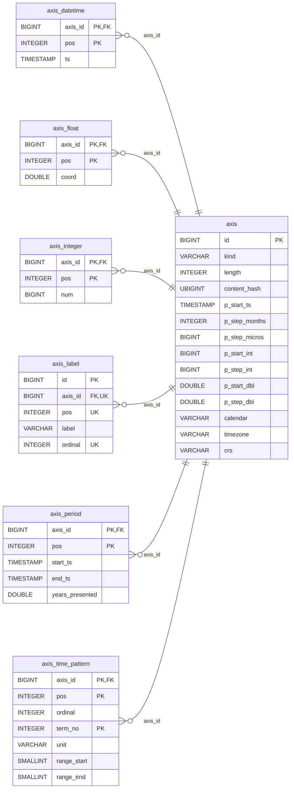

??? info "Columns: axis, axis_datetime, axis_float, axis_integer, axis_label, axis_period, axis_time_pattern"

    | Table | Column | Type | Null | Key |
    | --- | --- | --- | --- | --- |
    | `axis` | `id` | `BIGINT` |  | PK |
    | `axis` | `kind` | `VARCHAR` |  |  |
    | `axis` | `length` | `INTEGER` |  |  |
    | `axis` | `content_hash` | `UBIGINT` |  |  |
    | `axis` | `p_start_ts` | `TIMESTAMP` | yes |  |
    | `axis` | `p_step_months` | `INTEGER` | yes |  |
    | `axis` | `p_step_micros` | `BIGINT` | yes |  |
    | `axis` | `p_start_int` | `BIGINT` | yes |  |
    | `axis` | `p_step_int` | `BIGINT` | yes |  |
    | `axis` | `p_start_dbl` | `DOUBLE` | yes |  |
    | `axis` | `p_step_dbl` | `DOUBLE` | yes |  |
    | `axis` | `calendar` | `VARCHAR` | yes |  |
    | `axis` | `timezone` | `VARCHAR` | yes |  |
    | `axis` | `crs` | `VARCHAR` | yes |  |
    | `axis_datetime` | `axis_id` | `BIGINT` |  | PK,FK |
    | `axis_datetime` | `pos` | `INTEGER` |  | PK |
    | `axis_datetime` | `ts` | `TIMESTAMP` |  |  |
    | `axis_float` | `axis_id` | `BIGINT` |  | PK,FK |
    | `axis_float` | `pos` | `INTEGER` |  | PK |
    | `axis_float` | `coord` | `DOUBLE` |  |  |
    | `axis_integer` | `axis_id` | `BIGINT` |  | PK,FK |
    | `axis_integer` | `pos` | `INTEGER` |  | PK |
    | `axis_integer` | `num` | `BIGINT` |  |  |
    | `axis_label` | `id` | `BIGINT` |  | PK |
    | `axis_label` | `axis_id` | `BIGINT` |  | FK,UK |
    | `axis_label` | `pos` | `INTEGER` |  | UK |
    | `axis_label` | `label` | `VARCHAR` |  |  |
    | `axis_label` | `ordinal` | `INTEGER` |  | UK |
    | `axis_period` | `axis_id` | `BIGINT` |  | PK,FK |
    | `axis_period` | `pos` | `INTEGER` |  | PK |
    | `axis_period` | `start_ts` | `TIMESTAMP` |  |  |
    | `axis_period` | `end_ts` | `TIMESTAMP` |  |  |
    | `axis_period` | `years_presented` | `DOUBLE` | yes |  |
    | `axis_time_pattern` | `axis_id` | `BIGINT` |  | PK,FK |
    | `axis_time_pattern` | `pos` | `INTEGER` |  | PK |
    | `axis_time_pattern` | `ordinal` | `INTEGER` |  |  |
    | `axis_time_pattern` | `term_no` | `INTEGER` |  | PK |
    | `axis_time_pattern` | `unit` | `VARCHAR` |  |  |
    | `axis_time_pattern` | `range_start` | `SMALLINT` |  |  |
    | `axis_time_pattern` | `range_end` | `SMALLINT` |  |  |

### Value tiers

From `schema/050_values.sql`: `value_array`, `value_array_hist`, `value_long`, `value_scalar`.

**`value_array`**

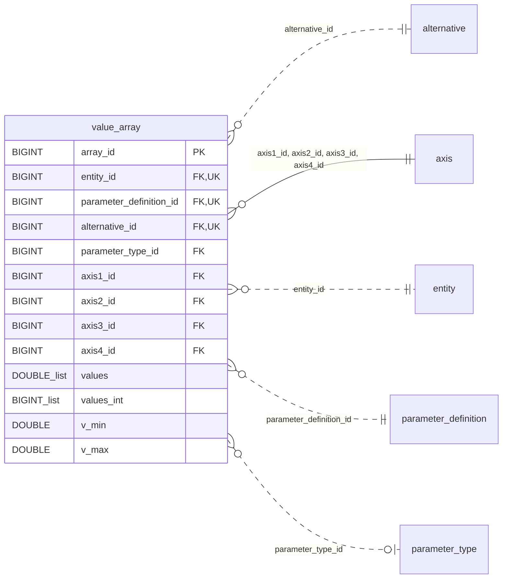

**`value_array_hist`**

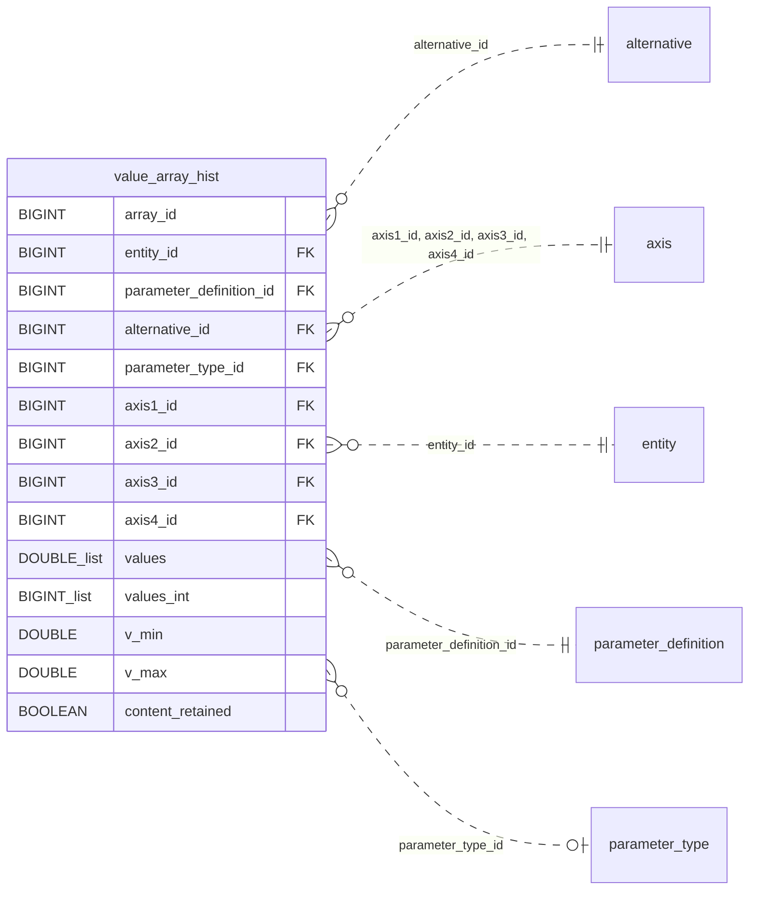

**`value_long`**

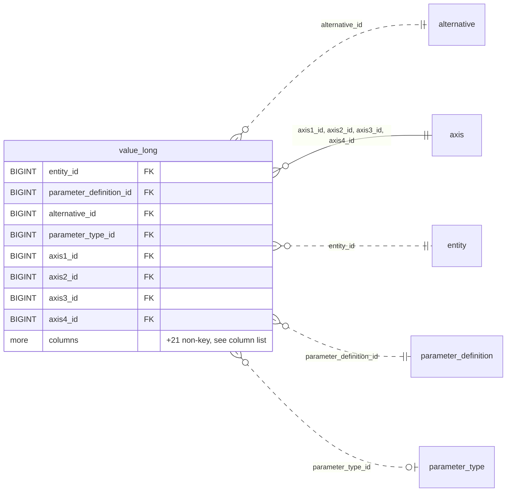

**`value_scalar`**

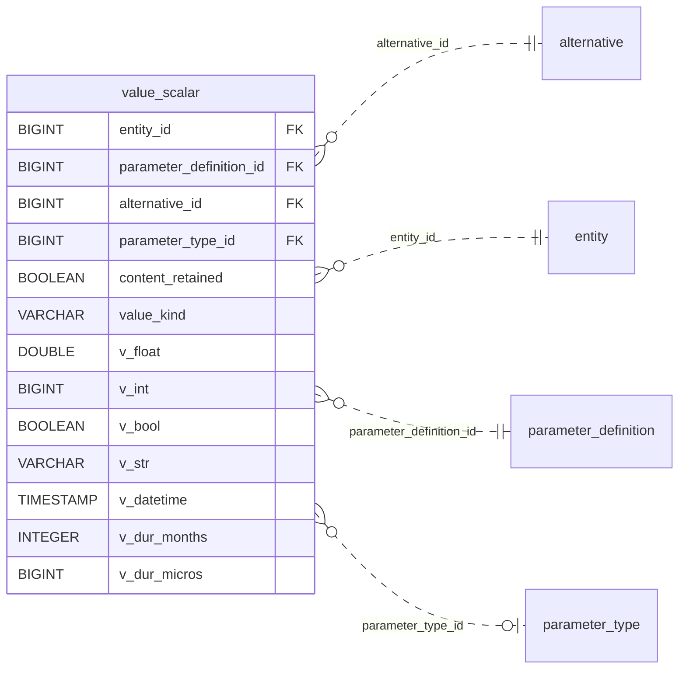

??? info "Columns: value_array, value_array_hist, value_long, value_scalar"

    | Table | Column | Type | Null | Key |
    | --- | --- | --- | --- | --- |
    | `value_array` | `array_id` | `BIGINT` |  | PK |
    | `value_array` | `entity_id` | `BIGINT` |  | FK,UK |
    | `value_array` | `parameter_definition_id` | `BIGINT` |  | FK,UK |
    | `value_array` | `alternative_id` | `BIGINT` |  | FK,UK |
    | `value_array` | `parameter_type_id` | `BIGINT` | yes | FK |
    | `value_array` | `valid_from_commit` | `BIGINT` |  | FK |
    | `value_array` | `version` | `SMALLINT` |  |  |
    | `value_array` | `axis1_id` | `BIGINT` |  | FK |
    | `value_array` | `axis2_id` | `BIGINT` | yes | FK |
    | `value_array` | `axis3_id` | `BIGINT` | yes | FK |
    | `value_array` | `axis4_id` | `BIGINT` | yes | FK |
    | `value_array` | `values` | `DOUBLE[]` | yes |  |
    | `value_array` | `values_int` | `BIGINT[]` | yes |  |
    | `value_array` | `v_min` | `DOUBLE` | yes |  |
    | `value_array` | `v_max` | `DOUBLE` | yes |  |
    | `value_array_hist` | `array_id` | `BIGINT` |  |  |
    | `value_array_hist` | `entity_id` | `BIGINT` |  | FK |
    | `value_array_hist` | `parameter_definition_id` | `BIGINT` |  | FK |
    | `value_array_hist` | `alternative_id` | `BIGINT` |  | FK |
    | `value_array_hist` | `parameter_type_id` | `BIGINT` | yes | FK |
    | `value_array_hist` | `valid_from_commit` | `BIGINT` |  |  |
    | `value_array_hist` | `version` | `SMALLINT` |  |  |
    | `value_array_hist` | `axis1_id` | `BIGINT` |  | FK |
    | `value_array_hist` | `axis2_id` | `BIGINT` | yes | FK |
    | `value_array_hist` | `axis3_id` | `BIGINT` | yes | FK |
    | `value_array_hist` | `axis4_id` | `BIGINT` | yes | FK |
    | `value_array_hist` | `values` | `DOUBLE[]` | yes |  |
    | `value_array_hist` | `values_int` | `BIGINT[]` | yes |  |
    | `value_array_hist` | `v_min` | `DOUBLE` | yes |  |
    | `value_array_hist` | `v_max` | `DOUBLE` | yes |  |
    | `value_array_hist` | `valid_to_commit` | `BIGINT` |  |  |
    | `value_array_hist` | `content_retained` | `BOOLEAN` |  |  |
    | `value_long` | `entity_id` | `BIGINT` |  | FK |
    | `value_long` | `parameter_definition_id` | `BIGINT` |  | FK |
    | `value_long` | `alternative_id` | `BIGINT` |  | FK |
    | `value_long` | `parameter_type_id` | `BIGINT` | yes | FK |
    | `value_long` | `valid_from_commit` | `BIGINT` |  | FK |
    | `value_long` | `valid_to_commit` | `BIGINT` | yes | FK |
    | `value_long` | `version` | `SMALLINT` |  |  |
    | `value_long` | `content_retained` | `BOOLEAN` |  |  |
    | `value_long` | `axis1_id` | `BIGINT` |  | FK |
    | `value_long` | `axis2_id` | `BIGINT` | yes | FK |
    | `value_long` | `axis3_id` | `BIGINT` | yes | FK |
    | `value_long` | `axis4_id` | `BIGINT` | yes | FK |
    | `value_long` | `i1_pos` | `INTEGER` |  |  |
    | `value_long` | `i2_pos` | `INTEGER` |  |  |
    | `value_long` | `i3_pos` | `INTEGER` |  |  |
    | `value_long` | `i4_pos` | `INTEGER` |  |  |
    | `value_long` | `i1_dt` | `TIMESTAMP` | yes |  |
    | `value_long` | `i1_num` | `BIGINT` | yes |  |
    | `value_long` | `i2_dt` | `TIMESTAMP` | yes |  |
    | `value_long` | `i2_num` | `BIGINT` | yes |  |
    | `value_long` | `i3_dt` | `TIMESTAMP` | yes |  |
    | `value_long` | `i3_num` | `BIGINT` | yes |  |
    | `value_long` | `i4_dt` | `TIMESTAMP` | yes |  |
    | `value_long` | `i4_num` | `BIGINT` | yes |  |
    | `value_long` | `value_kind` | `VARCHAR` |  |  |
    | `value_long` | `v_float` | `DOUBLE` | yes |  |
    | `value_long` | `v_int` | `BIGINT` | yes |  |
    | `value_long` | `v_bool` | `BOOLEAN` | yes |  |
    | `value_long` | `v_str` | `VARCHAR` | yes |  |
    | `value_long` | `v_datetime` | `TIMESTAMP` | yes |  |
    | `value_long` | `v_dur_months` | `INTEGER` | yes |  |
    | `value_long` | `v_dur_micros` | `BIGINT` | yes |  |
    | `value_scalar` | `entity_id` | `BIGINT` |  | FK |
    | `value_scalar` | `parameter_definition_id` | `BIGINT` |  | FK |
    | `value_scalar` | `alternative_id` | `BIGINT` |  | FK |
    | `value_scalar` | `parameter_type_id` | `BIGINT` | yes | FK |
    | `value_scalar` | `valid_from_commit` | `BIGINT` |  | FK |
    | `value_scalar` | `valid_to_commit` | `BIGINT` | yes | FK |
    | `value_scalar` | `version` | `SMALLINT` |  |  |
    | `value_scalar` | `content_retained` | `BOOLEAN` |  |  |
    | `value_scalar` | `value_kind` | `VARCHAR` |  |  |
    | `value_scalar` | `v_float` | `DOUBLE` | yes |  |
    | `value_scalar` | `v_int` | `BIGINT` | yes |  |
    | `value_scalar` | `v_bool` | `BOOLEAN` | yes |  |
    | `value_scalar` | `v_str` | `VARCHAR` | yes |  |
    | `value_scalar` | `v_datetime` | `TIMESTAMP` | yes |  |
    | `value_scalar` | `v_dur_months` | `INTEGER` | yes |  |
    | `value_scalar` | `v_dur_micros` | `BIGINT` | yes |  |

### Definition defaults and prefills

From `schema/050_values.sql`: `definition_value_array`, `definition_value_long`, `definition_value_scalar`.

**`definition_value_array`**

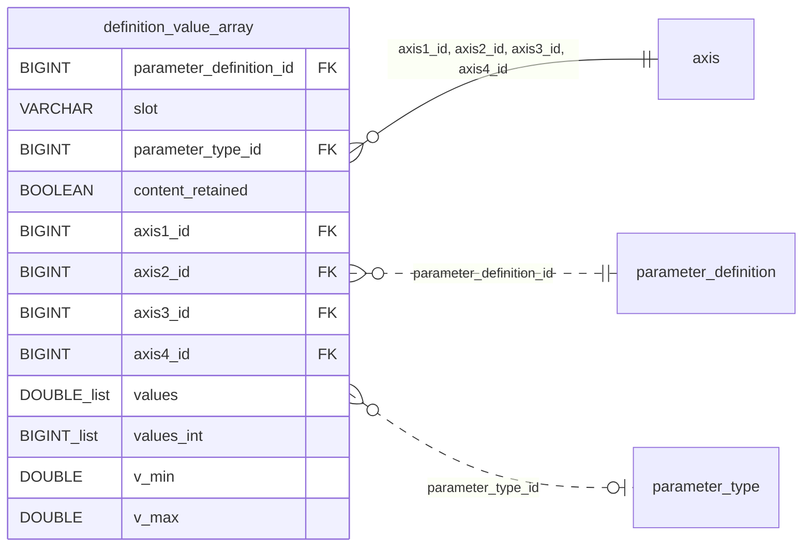

**`definition_value_long`**

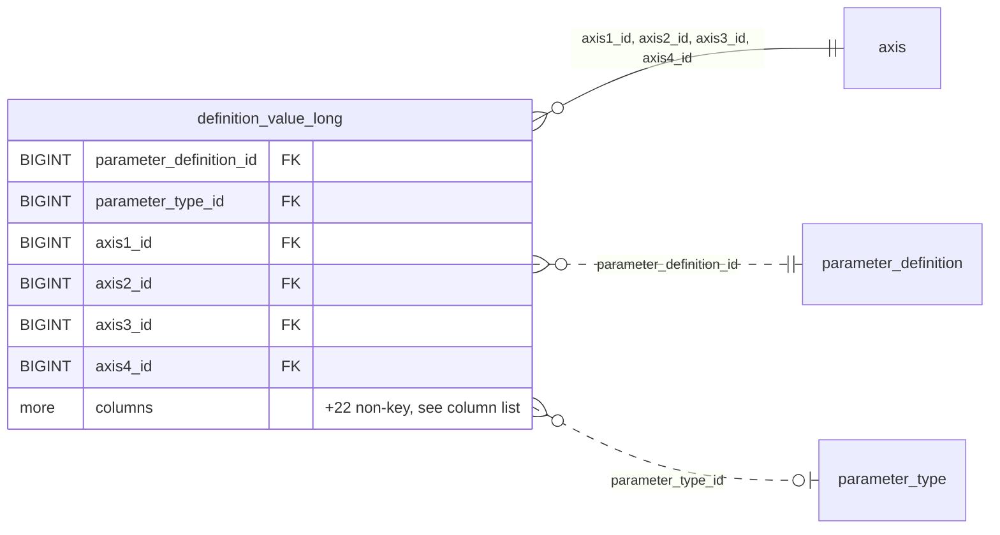

**`definition_value_scalar`**

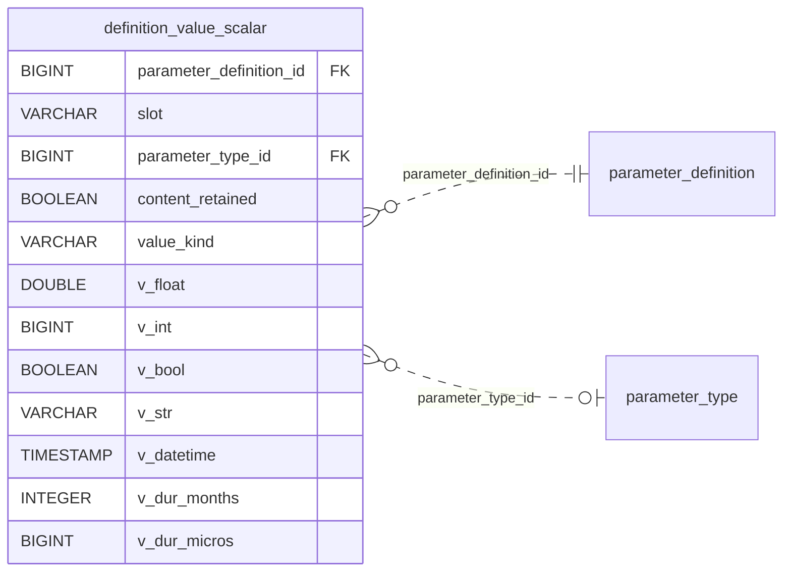

??? info "Columns: definition_value_array, definition_value_long, definition_value_scalar"

    | Table | Column | Type | Null | Key |
    | --- | --- | --- | --- | --- |
    | `definition_value_array` | `parameter_definition_id` | `BIGINT` |  | FK |
    | `definition_value_array` | `slot` | `VARCHAR` |  |  |
    | `definition_value_array` | `parameter_type_id` | `BIGINT` | yes | FK |
    | `definition_value_array` | `valid_from_commit` | `BIGINT` |  | FK |
    | `definition_value_array` | `valid_to_commit` | `BIGINT` | yes | FK |
    | `definition_value_array` | `version` | `SMALLINT` |  |  |
    | `definition_value_array` | `content_retained` | `BOOLEAN` |  |  |
    | `definition_value_array` | `axis1_id` | `BIGINT` |  | FK |
    | `definition_value_array` | `axis2_id` | `BIGINT` | yes | FK |
    | `definition_value_array` | `axis3_id` | `BIGINT` | yes | FK |
    | `definition_value_array` | `axis4_id` | `BIGINT` | yes | FK |
    | `definition_value_array` | `values` | `DOUBLE[]` | yes |  |
    | `definition_value_array` | `values_int` | `BIGINT[]` | yes |  |
    | `definition_value_array` | `v_min` | `DOUBLE` | yes |  |
    | `definition_value_array` | `v_max` | `DOUBLE` | yes |  |
    | `definition_value_long` | `parameter_definition_id` | `BIGINT` |  | FK |
    | `definition_value_long` | `slot` | `VARCHAR` |  |  |
    | `definition_value_long` | `parameter_type_id` | `BIGINT` | yes | FK |
    | `definition_value_long` | `valid_from_commit` | `BIGINT` |  | FK |
    | `definition_value_long` | `valid_to_commit` | `BIGINT` | yes | FK |
    | `definition_value_long` | `version` | `SMALLINT` |  |  |
    | `definition_value_long` | `content_retained` | `BOOLEAN` |  |  |
    | `definition_value_long` | `axis1_id` | `BIGINT` |  | FK |
    | `definition_value_long` | `axis2_id` | `BIGINT` | yes | FK |
    | `definition_value_long` | `axis3_id` | `BIGINT` | yes | FK |
    | `definition_value_long` | `axis4_id` | `BIGINT` | yes | FK |
    | `definition_value_long` | `i1_pos` | `INTEGER` |  |  |
    | `definition_value_long` | `i2_pos` | `INTEGER` |  |  |
    | `definition_value_long` | `i3_pos` | `INTEGER` |  |  |
    | `definition_value_long` | `i4_pos` | `INTEGER` |  |  |
    | `definition_value_long` | `i1_dt` | `TIMESTAMP` | yes |  |
    | `definition_value_long` | `i1_num` | `BIGINT` | yes |  |
    | `definition_value_long` | `i2_dt` | `TIMESTAMP` | yes |  |
    | `definition_value_long` | `i2_num` | `BIGINT` | yes |  |
    | `definition_value_long` | `i3_dt` | `TIMESTAMP` | yes |  |
    | `definition_value_long` | `i3_num` | `BIGINT` | yes |  |
    | `definition_value_long` | `i4_dt` | `TIMESTAMP` | yes |  |
    | `definition_value_long` | `i4_num` | `BIGINT` | yes |  |
    | `definition_value_long` | `value_kind` | `VARCHAR` |  |  |
    | `definition_value_long` | `v_float` | `DOUBLE` | yes |  |
    | `definition_value_long` | `v_int` | `BIGINT` | yes |  |
    | `definition_value_long` | `v_bool` | `BOOLEAN` | yes |  |
    | `definition_value_long` | `v_str` | `VARCHAR` | yes |  |
    | `definition_value_long` | `v_datetime` | `TIMESTAMP` | yes |  |
    | `definition_value_long` | `v_dur_months` | `INTEGER` | yes |  |
    | `definition_value_long` | `v_dur_micros` | `BIGINT` | yes |  |
    | `definition_value_scalar` | `parameter_definition_id` | `BIGINT` |  | FK |
    | `definition_value_scalar` | `slot` | `VARCHAR` |  |  |
    | `definition_value_scalar` | `parameter_type_id` | `BIGINT` | yes | FK |
    | `definition_value_scalar` | `valid_from_commit` | `BIGINT` |  | FK |
    | `definition_value_scalar` | `valid_to_commit` | `BIGINT` | yes | FK |
    | `definition_value_scalar` | `version` | `SMALLINT` |  |  |
    | `definition_value_scalar` | `content_retained` | `BOOLEAN` |  |  |
    | `definition_value_scalar` | `value_kind` | `VARCHAR` |  |  |
    | `definition_value_scalar` | `v_float` | `DOUBLE` | yes |  |
    | `definition_value_scalar` | `v_int` | `BIGINT` | yes |  |
    | `definition_value_scalar` | `v_bool` | `BOOLEAN` | yes |  |
    | `definition_value_scalar` | `v_str` | `VARCHAR` | yes |  |
    | `definition_value_scalar` | `v_datetime` | `TIMESTAMP` | yes |  |
    | `definition_value_scalar` | `v_dur_months` | `INTEGER` | yes |  |
    | `definition_value_scalar` | `v_dur_micros` | `BIGINT` | yes |  |

### The `run` table

From `schema/055_provenance.sql`: `run`.

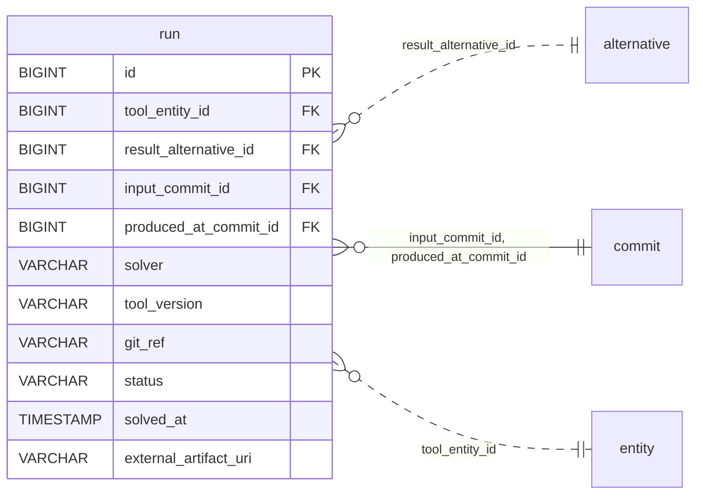

??? info "Columns: run"

    | Table | Column | Type | Null | Key |
    | --- | --- | --- | --- | --- |
    | `run` | `id` | `BIGINT` |  | PK |
    | `run` | `tool_entity_id` | `BIGINT` |  | FK |
    | `run` | `result_alternative_id` | `BIGINT` |  | FK |
    | `run` | `input_commit_id` | `BIGINT` |  | FK |
    | `run` | `produced_at_commit_id` | `BIGINT` | yes | FK |
    | `run` | `solver` | `VARCHAR` | yes |  |
    | `run` | `tool_version` | `VARCHAR` | yes |  |
    | `run` | `git_ref` | `VARCHAR` | yes |  |
    | `run` | `status` | `VARCHAR` | yes |  |
    | `run` | `solved_at` | `TIMESTAMP` | yes |  |
    | `run` | `external_artifact_uri` | `VARCHAR` | yes |  |

### Authored display modes

From `schema/060_display.sql`: `display_mode`, `entity_class_display_mode`.

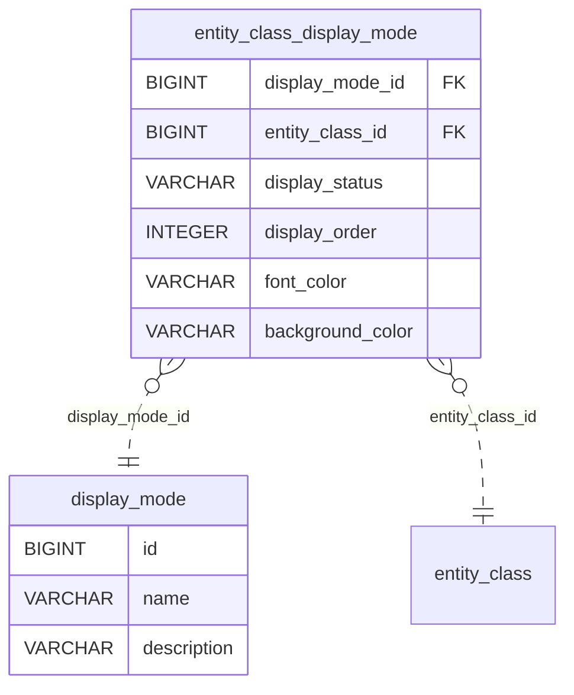

??? info "Columns: display_mode, entity_class_display_mode"

    | Table | Column | Type | Null | Key |
    | --- | --- | --- | --- | --- |
    | `display_mode` | `id` | `BIGINT` |  |  |
    | `display_mode` | `name` | `VARCHAR` |  |  |
    | `display_mode` | `description` | `VARCHAR` | yes |  |
    | `display_mode` | `valid_from_commit` | `BIGINT` |  | FK |
    | `display_mode` | `valid_to_commit` | `BIGINT` | yes | FK |
    | `display_mode` | `version` | `SMALLINT` |  |  |
    | `entity_class_display_mode` | `display_mode_id` | `BIGINT` |  | FK |
    | `entity_class_display_mode` | `entity_class_id` | `BIGINT` |  | FK |
    | `entity_class_display_mode` | `display_status` | `VARCHAR` |  |  |
    | `entity_class_display_mode` | `display_order` | `INTEGER` | yes |  |
    | `entity_class_display_mode` | `font_color` | `VARCHAR` | yes |  |
    | `entity_class_display_mode` | `background_color` | `VARCHAR` | yes |  |
    | `entity_class_display_mode` | `valid_from_commit` | `BIGINT` |  | FK |
    | `entity_class_display_mode` | `valid_to_commit` | `BIGINT` | yes | FK |
    | `entity_class_display_mode` | `version` | `SMALLINT` |  |  |

### Polymorphic ontology crosswalk

From `schema/065_semantic.sql`: `semantic_annotation`.

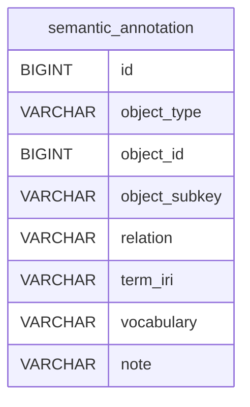

??? info "Columns: semantic_annotation"

    | Table | Column | Type | Null | Key |
    | --- | --- | --- | --- | --- |
    | `semantic_annotation` | `id` | `BIGINT` |  |  |
    | `semantic_annotation` | `object_type` | `VARCHAR` |  |  |
    | `semantic_annotation` | `object_id` | `BIGINT` |  |  |
    | `semantic_annotation` | `object_subkey` | `VARCHAR` | yes |  |
    | `semantic_annotation` | `relation` | `VARCHAR` |  |  |
    | `semantic_annotation` | `term_iri` | `VARCHAR` |  |  |
    | `semantic_annotation` | `vocabulary` | `VARCHAR` | yes |  |
    | `semantic_annotation` | `note` | `VARCHAR` | yes |  |
    | `semantic_annotation` | `valid_from_commit` | `BIGINT` |  | FK |
    | `semantic_annotation` | `valid_to_commit` | `BIGINT` | yes | FK |
    | `semantic_annotation` | `version` | `SMALLINT` |  |  |
