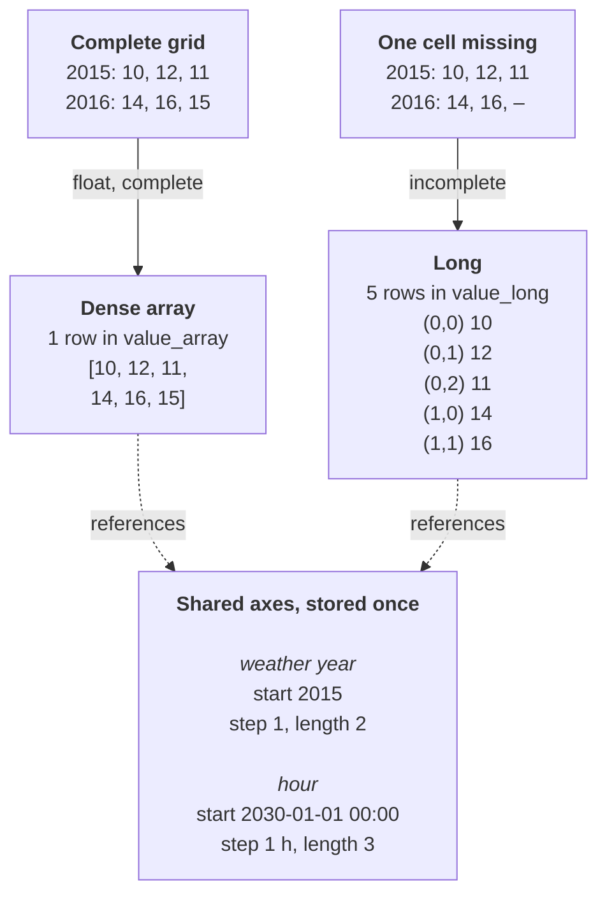

# Design rationale: value storage

This page explains how nodal-db stores parameter values and why: which
alternatives were considered, what was chosen, and what the choice costs
and buys in performance. It is written for contributors, for integrators
deciding how to read and write data, and for evaluators who want to know
what to expect at scale.

The page covers the reasoning. For what the tiers are, see
[Storage tiers](../features.md#storage-tiers). For the write pipeline
and module layout, see [Architecture](architecture.md).

Performance figures on this page are measurements under stated
conditions, not guarantees. Where a statement is a judgment rather than
a measurement, the text says so.

## In brief

- **Three storage tiers, chosen by the core from the data.** Values with
  no index are scalars. Float values on a complete grid are dense
  arrays: one row per value holding one flat list of numbers, with
  coordinates computed from shared axes instead of stored per cell.
  Everything else is long format, one row per cell. Readers see the
  same long format whichever tier holds a value.
- **Why dense arrays:** complete float series, such as hourly profiles
  and model results, are the bulk of the data. A dense array is compact
  (about 8 bytes per value), is written and replaced as one row, carries
  its minimum and maximum for cheap inspection, and transfers a whole
  parameter as lists of numbers (8.76 million values in about 0.25 s in
  the benchmark below).
- **Dense array against long, measured** (DuckDB 2.0.0; conditions in
  [Measured figures](#measured-figures)):
    - *Reading one series, a slice or one cell* costs about 2.4 ms for a
      dense array through `read_parameter_dense`, and about 0.7–0.9 ms
      in the long tier. The long series in that benchmark are a tenth
      as long (876 cells against 8 760 values); for one cell of an
      8 760-cell series the long tier took 1.3 ms in a second
      benchmark. A slice is not cheaper than a whole dense value, but
      both are cheap on that path.
    - *Bulk reads* favour dense arrays: list form avoids one row per cell.
    - *Writes* favour dense arrays: about 1 µs per value against about
      14 µs per cell for a new long value.
    - *Storage* favours dense arrays in nodal-db: about 8 bytes per value
      against about 30–34 bytes per long cell. The long table itself
      takes about 20 of those (a lean long table in plain DuckDB stores
      about 4–8 bytes per cell); about half of the 20 is the unique index
      that guarantees one current row per cell, and most of the rest is
      a copy of the time coordinate. The other tables the import fills
      add the remainder.
- **Where long wins or ties:** point and slice reads of one series or a
  few (somewhat faster or level), filtered reads through the canonical
  `read_parameter` (much faster), and whole-table aggregates (much
  faster, measured only in plain DuckDB). Long is also the only tier for
  sparse grids and non-float values.
- **The tier cliff:** from two dimensions up, one missing cell moves a
  whole value to the long tier, which today costs about four times the
  storage.
- **Writes are whole-value in every tier.** Changing one cell writes a
  complete new version of the value, and the old version is kept as
  history unless retention is switched off. For long histories, a
  [history-free extract](../features.md#history-free-extract) writes a
  smaller file with the current content only.
- **Not implemented yet:** chunked storage of dense arrays is parked. See
  [Known limitations and open directions](#known-limitations-and-open-directions).

## The problem

A parameter value in nodal-db can be:

- a single number, flag, string or timestamp,
- a time series, for example 8 760 hourly values for a year,
- a map keyed by labels or integers,
- a combination of up to four dimensions, for example weather year ×
  hour, or forecast × issue time × lead time.

Value kinds are `float`, `int`, `bool`, `string` and `date_time`. Sizes
range from one number to millions of cells per parameter: a model result
of 1 000 entities × 8 760 hours is 8.76 million values for one parameter.

The storage has to meet these requirements at the same time:

- **Readable with plain SQL.** Any DuckDB client must be able to query
  values without a nodal-db library.
- **Fast bulk reads.** A model loads whole parameters at once and should
  not pay per-cell overhead for dense time series.
- **Append-only history.** Every change is a new version tied to a
  commit; old versions remain readable with as-of queries.
- **One canonical form.** The same logical value must always produce the
  same stored rows and the same canonical encoding, whoever writes it,
  so that history diffs, equality
  checks and axis sharing work.

## Options considered

### Opaque encoded value per row

Each value is serialized into one column (for example as JSON or a
binary container) and decoded by the application. The Spine database
schema, which much of nodal-db's data model is based on, stores
parameter values as one encoded value column with a separate type
column.

- **For:** one simple table for all shapes; any value shape fits; a
  value is read or written as a unit.
- **Against:** the database engine cannot see inside a value, so SQL
  cannot filter, join or aggregate on individual cells. Reading any part
  of a value means fetching and decoding all of it. (nodal-db's dense
  arrays share this for their list of numbers: a slice costs what the
  whole list costs. Their minimum, maximum and keys stay visible to SQL;
  see [Performance in principle](#performance-in-principle).) Canonical encoding
  and equality become the job of every application that writes values,
  and independent encoders can drift apart.

nodal-db does not use this approach: values are stored in typed columns
that the engine understands.

### One row per cell for everything (long format only)

Every cell is a row carrying its keys, its coordinates and its value.

- **For:** fully relational; handles any shape, sparse or dense, and any
  value kind; a filter on a coordinate is an ordinary `WHERE` clause.
- **Against:** dense series carry keys and coordinates on every cell.
  How much that costs depends heavily on the schema around the rows:
    - A *lean* long table, sorted by key, costs little. In plain DuckDB
      (no nodal-db schema), a `(key, position, value)` table held 87.6
      million hard-to-compress floats in about 7.8 bytes per value, close
      to the 7.1–10 bytes of the same data as lists, and answered point
      and slice reads in under 1 ms (see
      [Raw formats](#raw-formats-without-the-nodal-db-schema)).
    - nodal-db's *own* long tier costs more: about 30–34 bytes per cell
      and about 14 µs per written cell, against about 8 bytes and 1 µs
      per dense-array value. The biggest single part of the size is one
      unique index that guarantees at most one current row per cell (see
      [Storage](#storage)); the write cost was not broken down further.
      Returning a whole parameter in long form also takes seconds where
      list form takes a fraction of a second, because the read views
      compute every cell's coordinates.

So a long-only design is not ruled out by the format itself. It was not
chosen because dense arrays also give one row per value, cheap
whole-value replacement and list-form bulk transfer (see the next
sections).

### One dense array for everything

Every indexed value is a rectangular array.

- **For:** compact and fast for dense numeric data.
- **Against:** sparse or ragged data has to be padded with missing-value
  markers or encoded raggedly inside the array, and non-numeric values
  fit poorly. With sparse data, a dense layout spends storage and memory
  on cells that do not exist, and the missing-value markers can reach
  computations if a reader does not skip them.

### Chosen: three tiers, picked automatically from the data

nodal-db combines the two native representations and adds a third for
the common case of a single value:

| Tier (`tier` value) | Holds | Layout |
|---|---|---|
| Scalar (`scalar`) | values with no index | one value |
| Dense array (`array`) | float values on a complete grid, 1–4 dimensions | one flat list of numbers against shared axes; coordinates come from the axes |
| Long, row-per-cell (`long`) | everything else: incomplete grids and non-float values, 1–4 dimensions | one row per cell, each with its own coordinates |

The reasoning: sparse data is naturally stored as records, dense data
as arrays, and a store that serves both well needs both natively.
Choosing between them is a physical storage decision, so it is hidden
from readers: every read view and macro presents the same long format.

Dense arrays are kept for complete float grids even though a lean long
table can match them on size and point reads, because of what one row
per value gives:

- **Compact.** About 8 bytes per value in a one-commit file, with no
  per-cell keys, and no larger than the same lists stored in plain
  DuckDB (7.1–10 bytes per value): the tier adds little on top of the
  format.
- **One row per value.** A 1 000-entity × 8 760-hour result is 1 000
  rows, not 8.76 million, in the table, in the catalog of what exists,
  and in every history step.
- **Cheap minimum and maximum.** Each row stores them, so a reader can
  inspect a value's range without touching its numbers.
- **Whole-value replace.** A new version is one row update, plus one
  row copied to history when retention is on; no per-cell close-out.
- **Fast bulk transfer.** `read_parameter_dense` returns each value as
  one list of numbers, which maps directly to an Arrow list column or a
  NumPy array.

Long rows win or tie elsewhere; see
[Dense array against long, by operation](#dense-array-against-long-by-operation).

### Smaller decisions within the chosen design

| Question | Decision | Why |
|---|---|---|
| Who picks the tier? | The core, from the data. Callers cannot. | The same data must always land in the same form; otherwise history diffs and equality checks break between writers. |
| One table per value kind (float, int, string, …)? | No. One table per tier, with typed columns (and a `value_kind` tag on the scalar and long tables). | Per-kind tables would multiply the tables every read view must combine. Judgment, not measured: little would be gained, because mostly empty typed columns compress to almost nothing in a columnar store. |
| Split very long arrays into chunks? | No, one row per value. | DuckDB already splits list data into storage blocks, so chunks are not needed for storage. They would not make history cheaper either, because every write replaces the whole value. See [Chunks and partial versioning](#chunks-and-partial-versioning). |
| Deduplicate identical arrays? | No (identical *axes* are deduplicated). | Each value row belongs to exactly one entity, parameter and alternative. Sharing one profile between many entities can be modelled explicitly instead, for example as a profile on a shared entity scaled by a per-entity factor. |
| History of dense arrays: in the same table or separately? | Separately: `value_array` holds current rows only; superseded rows move to `value_array_hist`. Scalar and long values keep history in the same table. | Superseded arrays can be megabytes each. Keeping them out of the current table means bulk reads of current data never scan them. Superseded scalar and long rows are narrow and are only marked as closed, never copied. |
| Dense arrays of integers? | Not yet. Integer values use the long tier. | Dense numeric float data is the main performance case. The schema has a reserved integer-list column on `value_array` that the read views already understand, but the core does not write it yet. |

#### Chunks and partial versioning

Splitting an array into chunks would not, by itself, let an edit store
only the chunk it changed. Today every write replaces the whole value:
the write API takes whole values, the canonicalization pipeline derives
the axes and the tier from the whole value, and the history model gives
one version number to each value. With chunks, an edit would still
rewrite every chunk.

Versioning chunks separately is not implemented. It would need:

- a chunk number in the key of `value_array` and `value_array_hist`,
  with version numbers counted per chunk, and history checks and the
  value timeline changed to match;
- a chunk size fixed as part of the canonical form, so that the same
  data always splits the same way; existing arrays would have to be
  converted to it;
- read views that join the chunks of a value back together, in order;
- a write path that compares the new value with the stored one to find
  the changed chunks, which means reading the stored array first;
- per-array minimum and maximum computed across chunks.

Even then it would apply only to edits that keep the axes and the tier
unchanged. Adding or removing a coordinate changes the derived axes,
and with them every chunk; removing one cell of a multi-dimensional
value moves it to the long tier. As-of reads would need no new idea:
they already select each row by its own commit span.

For comparison, the long tier already counts versions per cell in its
schema, but its write path still closes out and re-inserts every cell
of a value on each write.

## How the chosen design works

### The tier rule

After the canonicalization pipeline has dropped NULL cells, derived the
axes from the data and sorted the cells, the core applies one rule:

- no index → **scalar**;
- one or more dimensions, `float` values, and every combination of the
  axis coordinates present → **dense array**;
- otherwise → **long**.

Two consequences follow from deriving the axes from the data:

- **A one-dimensional float series is always a dense array.** Its axis
  is exactly the set of its own coordinates, so it is always complete.
  A series with gaps gets its own irregular axis instead of moving to
  the long tier.
- **From two dimensions up, one missing cell moves the whole value to
  the long tier.** A 3 × 8 760 grid with one hole is stored as
  26 279 long rows. Readers do not see the difference, but storage and
  write cost do (see below).

Example: a demand profile given for two weather years (2015 and 2016)
over the first three hours of the model year 2030, once complete and
once with one cell missing. Rows are weather years, columns are hours
00:00, 01:00 and 02:00:

The dense array stores its cells in row-major order: the last dimension
varies fastest. The long rows store each cell's position on each axis;
for time and integer dimensions they also carry a copy of the
coordinate to speed up filtering.

### Shared and parametric axes

An axis is a separate, immutable object that values point to. Two
properties make axes cheap:

- **Parametric form.** A regular axis, such as every hour of a year, is
  stored as start, step and length: three numbers, however long the
  axis. Coordinates are computed when read (start + position × step).
  Only irregular axes store one row per coordinate.
- **Sharing.** Axes are content-addressed: an axis identical to an
  existing one is reused. Every hourly series for the same year points to
  the same axis row.

As a result, a dense array stores no timestamps at all, and a thousand
hourly series on the same year share one three-number axis. Long rows
point to the same axes.

**Rendering coordinates when reading.** A read computes each cell's
coordinate from its own position (`start + position × step`, through the
scalar macros `axis_param_ts`, `axis_param_num` and `axis_param_coord`)
and joins stored coordinates only for the axes current values use. It
used to join `axis_position`, which lists every position of every axis
in the file, once per dimension. A file with 500 extra hourly axes then
paid 0.5 to 1.5 s more on every `value_rows` and `read_parameter` call,
scalar reads included, whether or not anything used those axes. Three
choices follow:

- *Arithmetic, not a filtered expansion.* Filtering the expansion to the
  axes in use first (`WHERE axis_id IN (…)` in front of
  `unnest(range(length))`) only works when the optimizer pushes the
  filter below the UNNEST, which it did not in one measured plan.
  Computing the coordinate per cell costs a little more than probing a
  small expanded table, but it does not depend on the axis count or on
  the optimizer. There is no accumulation: each position is computed
  from the start, exactly as the expansion did, so the result is
  bit-identical (a test compares every rendering surface, floats by bit
  pattern, against the old text). A side effect, in the safe
  direction: the expansion evaluated every position of every
  parametric axis, so one axis whose arithmetic overflowed at a high
  position made every read fail; now only rendered positions are
  evaluated, and such a file reads where it used to fail.
- *The stored-position legs are written twice*, once unfiltered
  (`axis_position_stored`, behind `axis_position`) and once filtered to
  the axes in use (`axis_position_stored_in_use`). The spellings with one
  text (an axis-id list argument, or a filter on the unfiltered view)
  were measured and fell apart on a file with 500 stored axes. The
  equality test covers both copies, so they cannot drift apart silently.
- *`read_parameter` reads one parameter's rows only.* It no longer joins
  the parameter to `value_rows` above the tier union, where the filter
  never reached the array tier: every call unnested every array in the
  file (8.76 million cells on the gate's fixture), even for a scalar
  parameter.

The remaining cost is in `value_rows`: a view cannot see the caller's
filter, so it joins the stored positions of every axis any current value
uses, and finds them with one scan of the long tier's key columns per
call. On a one-axis file that makes a `value_rows` point read a few tens
of milliseconds slower than before, growing with the long tier; on a
file whose values own hundreds of irregular axes it is slower than the
expansion was. Engine reads use `read_parameter` and the point-read
macros instead ([engine rules](engine_rules.md) §7).

### Canonical form

Before the tier decision, every value goes through one canonicalization
pipeline in the core, and axes and values have a fixed byte encoding.
Because the tier is a deterministic function of the canonical content,
the same data always ends up in the same tier with the same canonical
encoding. This
is what allows equality checks, axis deduplication and diffs across
history without comparing values cell by cell in application code.

### One read shape, two read paths

- `read_parameter`, `value_rows` and `value_cells` return every tier as
  long rows. Dense arrays are expanded into one row per cell inside the
  query.
- `read_parameter_dense` returns dense arrays as they are stored: one
  row per value with the list of numbers and the axis ids, plus the
  minimum and maximum of each array. The client computes coordinates
  from the axes. This is the fast path for bulk reads.

## Performance in principle

`n` is the number of cells in the value. The table describes how each
tier works; measured figures for both tiers follow in
[Measured figures](#measured-figures).

| Operation | Dense array | Long |
|---|---|---|
| Read a whole value | One row and one list of `n` numbers, no per-cell keys. Through `read_parameter_dense` or `value_cells` the row is fetched by its `array_id` with an index scan. A read that reaches the row through a sequential scan instead pays a cost set by how much list data is stored around it, not by `n`. | `n` rows, each with keys, positions and a value. Rows of one value are stored together, so DuckDB skips most of the table using per-block minimum and maximum keys. |
| Read a slice (a time window, or one index of a multi-dimensional value) | Costs the same as reading the whole value (see below). | A filter on positions or coordinates over the value's rows. |
| Read one cell | Same as a slice. | Same as a slice. |
| Write a new value | One row; the whole list is bound as one SQL list parameter. | `n` rows, inserted by one statement that binds each column as a list (up to 16 384 cells per execution). |
| Change one cell | The whole value is rewritten: the old row (all `n` cells) is copied to `value_array_hist` and the current row is replaced. | Only the changed cell is rewritten: its current row is closed out (marked, not copied) and one new row is inserted. The other cells keep their rows. This holds while the axes, the value kind and the parameter type stay the same; otherwise all `n` rows are closed and `n` new rows inserted. |
| History growth per change | About one extra copy of the value. | One row per changed cell. |
| Effect of history on current reads | No effect on scans of current data: superseded arrays live in a separate table. The file grows (see below). | Closed-out rows share the table; scans of current rows skip blocks that hold only closed-out rows. |

Notes on the table:

- **Slices of dense arrays are not cheaper than whole reads.** This was
  measured: slicing in SQL (`values[a:b]`), unnesting and filtering, and
  fetching the whole list and slicing in the client all cost the same.
  DuckDB does not skip parts of a list column. Through
  `read_parameter_dense` and `value_cells` that cost is small, because
  the row is found by its `array_id`: about 2.4 ms for one 8 760-value
  array, whether one cell, one week or the whole series is wanted. A
  query that reaches the list through a sequential scan (a filter on the
  key triple directly on `value_array`, or more than 50 values at once)
  pays for scanning a large part of the stored list data, whatever the
  size of the slice: tens of milliseconds in the measurements below.
  The canonical `read_parameter` expands dense arrays into cells before
  a filter applies, so a filtered read through it costs about as much as
  reading the whole parameter. Smaller row groups did not reduce the
  scan cost in the tests. Reading only the per-row minimum and
  maximum, without touching the list, takes under a millisecond on the
  table itself.
- **The write API takes whole values.** There is no per-cell update
  call. Writing a value identical to the stored one creates no version:
  the core compares the stored columns and skips it, and a call that
  changes nothing makes no commit. A long value is compared cell by
  cell (the *cell diff*): on the same axes, value kind and parameter
  type, a changed cell is closed out and re-inserted at its version + 1,
  a removed cell is closed out, an added cell is inserted at its
  position's highest version + 1, and an equal cell is left alone. A
  long value's current cells may therefore come from several commits,
  each with its own version; `value_timeline` turns them back into
  value-level versions, and `audit_long_value_coherence` checks that
  they still share one set of axes, one kind and one parameter type. On
  the 4.6 million-cell value of the scale study, a one-cell edit
  through the API costs about 3.3 s end to end, against about 62 s for
  the whole rewrite it replaces (paired A/B, 19x). Most of the 3.3 s is
  canonicalizing the incoming value; the write itself, the read and
  merge of the stored cells, takes about 0.8 s. Closing cells costs
  about 7 µs per cell when they are named by position, and about 5 µs
  per cell for the key-level UPDATE that closes a whole value. A diff
  that closes more cells of one value than it keeps (with at most 16 384
  kept) therefore closes "every cell but the kept ones" in one statement
  at the key-level rate, so a re-import in which nearly every cell
  changed costs what the whole rewrite cost. Between those cases the
  diff closes by position: with 10 % of the cells changed a save takes
  0.18 times the whole rewrite, with half 0.61 times, with 90 % the
  same. Dense
  arrays are still compared and rewritten whole: a partial update would
  copy the whole pre-image to `value_array_hist` anyway.
- **History can be kept without content.** When the parameter
  definition has `retain_content` set to false, or with the
  `force_replace` write option (or `retain_override` set to false), the
  superseded version is kept only as a stub: its version and commit edges remain, its payload
  does not. This suits regenerated data such as model results.
- **Storage size.** DuckDB compresses column data automatically; how
  much depends on the data. A dense array stores eight bytes per float
  before compression and no per-cell keys. A long row carries keys,
  positions and typed value columns (empty columns compress to almost
  nothing), and the long table carries a unique index that guarantees
  at most one current row per cell. That index costs about 9–13 bytes
  per current row on large values, about half of the long table's size
  (see [Storage](#storage)); closed rows are not in it. Many small
  commits leave the file fragmented; [compaction](../features.md#compaction) repacks it.
- **Memory on read.** A read returns whole values. Through
  `read_parameter_dense`, a dense array arrives as one list of `n`
  eight-byte floats plus a few ids, and the client holds the whole list
  even when it needs only part of it. Through `read_parameter` and the
  other long-form views, every cell becomes a row with the entity and
  alternative names, the tier and value kind, twenty index columns and
  seven value columns, most of them empty. That takes many times more
  client memory per cell than the list form; for large parameters, read
  dense values through `read_parameter_dense`.
- **Very long series.** A dense array is one row however long it is.
  The core holds the whole value in memory while canonicalizing and
  writing it, in a working form several times larger than its eight
  bytes per cell. The array is written as one row whose list is bound
  as a single SQL parameter; it cannot be split across statements. In
  the results-scale benchmark on DuckDB 2.0.0, a one-minute series for
  a year (525 600 values, 4.2 MB as raw floats) took 0.44–0.47 s to
  write through the core into a fresh file and 0.98–1.02 s to replace,
  with a peak of about 165–175 MiB of memory above the starting point
  (three runs, load average about 3–4; an earlier run at load 9–14
  measured 0.6–0.8 s and 1.3–1.6 s). Every edit, even of one cell, rewrites the
  whole array and, with retention on, copies the old one to history.
- **History growth and read speed.** Reads of current dense arrays use
  `value_array` only, so a growing `value_array_hist` does not slow
  them down. As-of reads combine both tables and pay for scanning the
  history table's list data as well, so they slow down as history grows
  (expected from the mechanism above, not measured). The file also
  grows with history and with the number of commits, and opening it
  costs more (see [History and file size](#history-and-file-size)).
  Each read opens and closes its own connection, so it pays this cost.
  Turning retention off for regenerated data,
  [compaction](../features.md#compaction) and a
  [history-free extract](../features.md#history-free-extract) limit the
  growth.

## Measured figures

All figures below were measured with DuckDB 2.0.0 on one machine: an AMD
Ryzen 9 5900XT (16 cores, 32 threads), 70 GB of memory, an NVMe SSD,
Linux, release builds with the DuckDB bundled by the core. The machine
was shared with other work; the load during each run is given with it.
Absolute numbers depend heavily on the machine and its load; ratios
within one table are more reliable than absolute values. Figures for
DuckDB 1.5.5, measured earlier, remain in the results files linked
below; they are not repeated here.

The sources:

- **Results-scale benchmark**
  ([`crates/nodal-db-cli/benches/results_path.rs`](https://github.com/nodal-tools/nodal-db/blob/main/crates/nodal-db-cli/benches/results_path.rs),
  `just bench-results`; results in
  [`scripts/bench/RESULTS_results_path.md`](https://github.com/nodal-tools/nodal-db/blob/main/scripts/bench/RESULTS_results_path.md)).
  Dense data: 10 parameters × 1 000 entities × 8 760 hourly floats
  (87.6 million values) with random full-precision values, chosen to be
  hard to compress, like solver output. Long data: 1 000 series × 876
  integer cells (every tenth hour). One full run on 2026-10-25 (`main`
  at `1507cf5`), 1-minute load average 1.7–5.6 during the core
  benchmark and 3.0–6.3 during the plain-DuckDB part. Reads are the
  minimum of 15 on an open connection ("warm"),
  or of 5 on a fresh connection with opening excluded ("cold").
- **Benchmark gate**
  ([`crates/nodal-db-core/benches/RESULTS.md`](https://github.com/nodal-tools/nodal-db/blob/main/crates/nodal-db-core/benches/RESULTS.md),
  `cargo bench`, the current-`main` column of 2026-10-25). A synthetic
  database written through the core: 1 000 dense arrays of 8 760
  floats, 1.23 million current long rows (integer cells), 100 000
  scalars; 136 MiB on disk. Reads hold an open connection and include
  conversion to Arrow. Load average 3.5–11 while measuring.
- **Write-path comparison** (`scripts/bench/ab_write_path/`, since moved
  to `scripts/bench/ab/harness/`). Old and
  new core, 21 interleaved pairs per row in random order, median of the
  per-pair ratios with a bootstrap 95 % interval; times per value
  through `history::write_value`, commit included. Load average 2–37;
  rows whose load changed by more than 2× were re-run at 2–7 and kept
  their ratios within 0.01.
- **Long-tier size breakdown**
  ([`scripts/bench/long_tier_size_breakdown.py`](https://github.com/nodal-tools/nodal-db/blob/main/scripts/bench/long_tier_size_breakdown.py),
  `just bench-long-size`; results in the results-scale file above).
  Python DuckDB 2.0.0, one thread, the long data of the results-scale
  benchmark (and, with `--shape`, a large sparse value and rank-3
  values). Storage sizes do not depend on load; repeated runs gave
  identical figures.

### Dense array against long, by operation

The two data sets differ, so read the rows with care:

- In the results-scale benchmark a dense series has 8 760 float values
  and a long series 876 integer cells (every tenth hour). The read rows
  for one series, one week and one cell therefore compare the same
  operation on different amounts of data, and the dense parameter holds
  ten times as many cells as the long one.
- In the benchmark gate both tiers hold 8 760-cell series (floats in
  dense arrays, integers in the long tier), and in the write-path
  comparison both write 8 760-cell values.
- Write, ingest and storage rows are also given per value or per cell.
  The long-tier figures are for integer cells; float cells, which
  compress less well, were not measured in the long tier.

| Operation | Dense array | Long tier | Source |
|---|---|---|---|
| One whole series | 2.35 ms (8 760 values; cold 6.0 ms) | 0.70 ms (876 cells; cold 1.7 ms) | results-scale |
| One week of one series | 2.48 ms (168 values) | 0.85 ms (17 cells) | results-scale |
| One cell | 2.37 ms; 2.66 ms in the gate (whole series, which costs the same) | 0.83 ms; 1.30 ms in the gate (one cell of an 8 760-cell series) | results-scale, gate |
| Minimum and maximum of one series | 0.73 ms (stored per row, read from the table); 2.36 ms through `read_parameter_dense` | 0.92 ms (computed over 876 cells) | gate, results-scale |
| One week from each of 20 series | 3.68 ms | 3.44 ms | results-scale |
| The same through `read_parameter` with a timestamp filter | 3 002 ms | 48.9 ms | results-scale |
| Whole parameter, list form (`read_parameter_dense`) | 253 ms for 8.76 million values (about 29 ns per value) | — | gate |
| Whole parameter, long form (`read_parameter`) | 3 278 ms for 8.76 million cells (about 0.37 µs per cell) | 1 045 ms for 1.23 million rows (about 0.85 µs per cell) | gate |
| Write a new 8 760-cell value | 7.7 ms (about 0.9 µs per value; 20 values per commit) | 125 ms (about 14 µs per cell) | write-path comparison |
| Replace an 8 760-cell value | 16.2 ms (about 1.8 µs per value) | 216 ms (about 25 µs per cell) | write-path comparison |
| Bulk ingest, one commit (Arrow-IPC import) | 1.66–1.73 million values/s | 214 000 values/s | results-scale |
| Bulk ingest, core API, 100 series per commit | 894 000–1.33 million values/s | 168 000 values/s | results-scale |
| Storage, one commit, net of the empty schema | 8.1–8.4 bytes per value | 29.6 bytes per cell | results-scale |
| Storage, many commits, before compaction | 11.4–14.9 bytes per value | 33.8 bytes per cell | results-scale |

Reading the table:

- **Point, slice and whole-value reads are close.** The long tier is
  somewhat faster on one series (about 0.7–0.9 ms against about 2.4 ms;
  for one cell at equal series length, 1.30 against 2.66 ms in the
  gate); for 20 series the two are level. A whole long series of 8 760
  cells was not read through the core; in plain DuckDB a lean long
  table returned one in 0.77 ms (see
  [Raw formats](#raw-formats-without-the-nodal-db-schema)). Both are well under the cost of
  opening a connection (29 ms on a fresh connection to the
  one-commit file), which a per-operation reader pays as well.
- **Long wins filtered reads through `read_parameter`.** A dense array
  is expanded into one row per cell before a coordinate filter applies,
  so the filtered read costs about as much as reading the whole
  parameter. For dense data, filter after `read_parameter_dense`
  instead (the 3.68 ms row above). The dense parameter here also holds
  ten times as many cells as the long one.
- **Dense wins bulk reads and writes.** In list form a whole dense
  parameter costs about 29 ns per value. Writes are about 15–18 times
  cheaper per value than long-tier writes, and bulk ingest about 5–8
  times faster.
- **Dense wins storage, by about four times.** The gap is mostly
  nodal-db's own long-tier overhead, not the long format; see the next
  two sections.

### Storage

nodal-db's long tier costs about 30 bytes per cell (29.6 in one commit,
33.8 over ten commits; net of the empty schema), against about 4.2 bytes
for the same integer cells in a lean long table in plain DuckDB (next
section): about seven times more.

A size breakdown attributes this to parts of the schema
([`scripts/bench/long_tier_size_breakdown.py`](https://github.com/nodal-tools/nodal-db/blob/main/scripts/bench/long_tier_size_breakdown.py),
`just bench-long-size`). It builds the long table from the real schema,
writes the same 876 000 integer cells in one commit, and removes one
part at a time, measuring the storage blocks in use after a checkpoint
(DuckDB 2.0.0; one 256 KiB block is about 0.3 bytes per cell, so that
is the resolution):

| Part | Bytes per cell |
|---|---|
| The 7-column unique index that guarantees at most one current row per cell | 9.3 |
| The copy of the time coordinate that long rows carry for time dimensions | 6.3 |
| Keys, positions, values and all other columns | 4.2 |
| Foreign keys (DuckDB keeps a hidden index for each) | 0.6 |
| **The long table and its indexes** | **20.4** |

- Without the index, the foreign keys and the time copy, the long
  table stores these cells in the same 4.2 bytes as the lean table. The
  history columns and the empty typed value columns cost nothing
  measurable: DuckDB stores a column segment that is entirely empty or
  constant as a constant.
- The same breakdown on a file written by the core gives the same
  9.3 bytes per cell for the index. The other 8.4 bytes per cell in
  that file are the other tables the benchmark fills (1 000 entities,
  the commit, the axis and so on) and their indexes, about 7 MiB; they
  grow with the number of entities, not with the number of cells per
  series.
- Closed rows cost nothing in the unique index: all its columns are
  empty (NULL) on a closed row, and DuckDB does not index such keys.

**Key order.** The unique index covers seven columns: entity, parameter
and alternative, and the four positions. The same seven columns cost
57.8 or 9.3 bytes per cell depending only on their order. DuckDB's
index (an adaptive radix tree) shares the key bytes that rows have in
common and stores the rest per row, so every column that is constant
within a value (positions beyond the value's rank, the key triple, the
high zero bytes of each position) costs bytes on every row when it
comes last. The index therefore puts those columns first and the first
position, which varies most within a large value, last. Uniqueness does
not depend on the order, so the rule it enforces is the same. Measured
with the same script:

| Shape | Old order | Current order |
|---|---|---|
| 1 000 series × 876 cells (the table above) | 57.8 | 9.3 |
| One sparse 8 760 × 840 map at 62 % fill (4.56 million cells) | 61.5 | 13.2 |
| 1 000 rank-3 values of 5 × 8 × 24 at 90 % fill | 81.8 | 38.2 |

The rank-3 case is the order's weak spot: with only five values of the
last column per subtree, each row also pays for a half-empty node. No
single order is best for every shape; this one is best for the large
values where the bytes add up. A test (`tests/long_index_size.rs`) fails
if the order or a DuckDB upgrade makes the index grow again; write
times did not change.

The dense-array tier, by contrast, adds little on top of its format:
8.4 bytes per value at 10 000 series, within the 7.1–10.0 bytes of the
same lists in plain DuckDB (next section).

A separate current-row table for the long tier (as for dense arrays)
was measured as an alternative to the unique index. It came out no
smaller than the reordered index and gave reads nothing, so it was not
adopted.

**The tier cliff, measured.** From two dimensions up, one missing cell
moves the whole value to the long tier. A 3 × 8 760 float grid with one
hole becomes 26 279 long rows: at 29.6–33.8 bytes per cell about
0.78–0.89 MB, against about 0.22 MB as a complete dense array at 8.4
bytes per value, about four times more. (The long figure was measured
on integer cells; float cells were not measured in the harness.) It
also costs the long-tier write rate, about 14 µs per cell instead of
about 1 µs.

### Raw formats without the nodal-db schema

The same 87.6 million values in plain DuckDB 2.0.0 (Python), with no
nodal-db schema: lists in a `(key, minimum, maximum, values)` table, and
a lean long table `(key, position, value)`, both sorted by key, with no
indexes. "Lean long, integer" is the long shape above (1 000 × 876
integer cells). From the same results-scale run, one pass; warm minimum
of 15, in ms.

| | Dense lists, default row groups | Dense lists, 2 048-row groups | Lean long |
|---|---|---|---|
| Bytes per value, net | 9.97 | 7.12 | 7.77 (integer shape: 4.19) |
| One cell | 102.5 | 94.7 | 0.85 |
| One week (168 values) | 97.9 | 93.8 | 0.98 |
| One whole series (8 760) | 96.0 | 93.9 | 0.77 |
| Minimum and maximum of one series | 0.44 (stored) | 0.45 (stored) | 1.43 (computed) |
| One week from each of 20 series | 323 | 95.3 | 1.74 |
| Aggregate over the whole table | 699 | 760 | 23.1 |

- A sorted, narrow long table is no larger than the lists for
  hard-to-compress floats: sorted keys and positions compress to almost
  nothing.
- The raw list tables have no key index, so their point reads scan the
  list data (about 100 ms). nodal-db's dense tier avoids this through its
  `array_id` index (2.4 ms, above); the lean long table needs no index,
  because DuckDB skips blocks by their key ranges.
- A full-table aggregate is about 30 times faster on the lean long table
  (23 ms against 699–760 ms). The same aggregate was not measured on
  nodal-db's own tiers.

### History and file size

- **Opening a file** written in many commits costs noticeably more:
  29 ms for the 701 MiB results file written in one commit, 114 ms for
  the 958 MiB file holding the same data written in 100 commits (fresh
  connection, results-scale run).
- **Closed-out long rows** did not slow scans of current rows in the
  gate: a scan of the current long rows took 15.5 ms with 17.6 % of rows
  closed out and 15.0 ms with 33.3 %. The likely reason: after a
  checkpoint, closed-out rows cluster into whole row groups, which the
  scan skips by their stored ranges.
- **A history-free extract** removes superseded versions into a new
  file ([`nodal-db extract`](../features.md#history-free-extract)). In
  its benchmark (`cargo bench -p nodal-db-core --bench extract`; a
  source of 100 dense arrays × 10 versions, 90 % of the array data
  superseded, plus a small long-tier part; 2026-10-25, load average
  5–11), the extract was 16.8 MiB against 43.3 MiB for a compacted copy
  of the source (2.6 times smaller) and 75.3 MiB for the uncompacted
  source (4.5 times). Compaction alone accounts for the first step. A fixed
  per-file overhead and the live data remain, so the gain stays well
  below what the dead fraction alone suggests. The benchmark showed no
  read-speed benefit against the compacted file, and none is claimed.

### The `array_id` key, before and after

The results-scale data, ingested through the Arrow-IPC import lane into
one file per schema and read with the bundled DuckDB 2.0.0, on the same
host (load average about 2 to 8). Warm minimum over 15 reads; "cold" is
a fresh connection with opening excluded.

| Read | Before (composite key) | After (`array_id`) |
|---|---|---|
| One whole series, `read_parameter_dense` | 84.8 ms (cold 182 ms) | 2.4 ms (cold 6.1 ms) |
| One week of one series, or one cell | 85.0 / 84.9 ms | 2.4 / 2.5 ms |
| One week from each of 20 series, `read_parameter_dense` | 86.5 ms | 3.6 ms |
| The same through `read_parameter` with a timestamp filter | 2 751 ms | 2 946 ms |
| One series' minimum and maximum only | 2.0 ms | 2.3 ms |
| Import of the 87.6 million values, one commit | 1 200 s | 1 187 s and 1 219 s (two runs) |

The `read_parameter` path does not use the index yet and became a few
per cent slower. A paired, interleaved comparison of the whole-parameter
`read_parameter` read (one process, one file, 21 pairs) put the cost at
4.1 % (median ratio 1.041, 95 % bootstrap interval 1.003 to 1.059); the
later full re-run measured 5.2 % (1.052, interval 1.043 to 1.062). A
read of more than 50 series at once falls back to scanning the list
data (51 series: 88 ms warm in this comparison, 24 ms warm and 179 ms
cold in the later re-run, 90 ms warm and 192 ms cold in the
2026-10-25 re-run). The file grew by 256 KiB (0.04 %).

### The columnar write path, before and after

Until this change, a long value was inserted with multi-row `VALUES`
statements carrying 30 parameters per cell, an array with one parameter
per element, and each child row of a materialized axis with its own
statement. DuckDB 2.0 parses such statements several times more
slowly than 1.5.5 (preparing one 8 761-placeholder statement took about
64 ms against about 13 ms). Each column is now bound as one list parameter (see the
[architecture page](architecture.md)). Measured with the write-path
comparison described above:

| Write | Before | After | Ratio (95 % interval) |
|---|---|---|---|
| New 8 760-cell long value | 1 781 ms | 143 ms | 0.080 (0.080–0.081) |
| Replace an 8 760-cell long value | 1 851 ms | 239 ms | 0.127 (0.124–0.129) |
| New 8 760-value array (20 per commit) | 111 ms | 8.0 ms | 0.073 (0.072–0.074) |
| Replace an 8 760-value array (20 per commit) | 120 ms | 16.1 ms | 0.134 (0.133–0.137) |
| New long value on a new irregular 8 760-point datetime axis | 5 913 ms | 162 ms | 0.027 (0.027–0.028) |
| New scalar (400 per commit) | 7.0 ms | 2.9 ms | 0.42 (0.40–0.45) |
| Replace a scalar (400 per commit) | 5.8 ms | 2.8 ms | 0.48 (0.47–0.49) |
| 100 new scalar entities through `write_parameter` | 9.0 ms | 5.5 ms | 0.62 (0.60–0.65) |
| Read: current cells of one 876-cell long value | 0.61 ms | 0.60 ms | 1.01 (0.97–1.03), unchanged |

The stored rows are byte-identical before and after: a physical-write
golden test (`tests/write_path_golden.rs`) was generated by the old code
and passes unchanged. The import of the 87.6 million dense values
through `nodal-db import` (one commit) went from 1 200 s to 97 s (one
full-scale run, load average 4 to 12), with the file size identical to
the byte (735 326 208 B); the later full re-run measured 86 s.

### The set-based scalar write, before and after

DuckDB 2.0 serves a point lookup on the key triple, or on an entity
name, with a scan of the table rather than with the compound key index,
at a floor of roughly 0.5–1 ms per statement. The per-key scalar writer
spent five to eight such statements per value (name lookup, auto-create,
three live-tier probes, version, close-out, insert), about 5–8 ms per
value. A commit now resolves each segment's entity names in one
statement, buffers all of its scalars, and writes them in one round per
16 384 keys: one probe for the live tier and version, one close-out per
retention mode, one columnar insert (see the
[architecture page](architecture.md)). A round of one key uses
point-filter forms of the same statements, which are cheaper at that
size. Long and array values are unchanged. Measured with the write-path
comparison described above (whole commits; the 100 000-scalar file was
built once and copied per sample; load average 2.7–10.8, the one row
whose load moved by more than 2× was re-run at 4.6–8.0):

| Write | Before | After | Ratio (95 % interval) |
|---|---|---|---|
| 10 000 new scalar entities, one commit (per value) | 4.98 ms | 0.020 ms | 0.004 (0.004–0.004) |
| 100 new scalar entities on a 100 000-scalar file (per value) | 8.75 ms | 0.99 ms | 0.113 (0.109–0.115) |
| 100 new scalar entities on an empty file (per value) | 5.01 ms | 0.72 ms | 0.146 (0.143–0.148) |
| Editor-shaped save: 20 parameters × 1 value, one commit, 100 000-scalar file | 349 ms | 191 ms | 0.56 (0.54–0.57) |
| Single-value save, 100 000-scalar file (whole commit) | 94.2 ms | 95.3 ms | 1.00 (0.99–1.02) |
| New scalar through `write_value` (400 per commit, per value) | 2.74 ms | 2.60 ms | 0.94 (0.91–0.96) |
| Replace a scalar through `write_value` (400 per commit, per value) | 2.81 ms | 2.51 ms | 0.89 (0.89–0.90) |
| Long, array and axis writes; read of one long value | | | 0.99–1.01, unchanged |

The 10 000-entity row is the unit of the benchmark gate's synthetic
build: 100 000 scalars in 10 such commits now take seconds instead of
about ten minutes. The editor-shaped save gains most from resolving an
entity once per commit rather than once per segment; with a different
entity in each segment it gains less. A single-value save is dominated
by opening and closing the file and does not change.

The stored rows are byte-identical: the physical-write golden was
extended with API-path scalar commits (several scalar segments, tier
transitions, retention, deletes in the same commit), generated by the
per-key writer, and passes unchanged; a randomized script of 220–400
commits per seed (7 seeds) gave identical row dumps on both writers.
Two error paths changed on purpose. Two spellings of one entity that only
DuckDB's Unicode `lower()` folds together (`"Ä"` and `"ä"`) in one batch
are now rejected with the same error as an ASCII case alias, instead of
failing later on a raw constraint error. Two segments whose
class, parameter or alternative names resolve to the same target in the
database are rejected as a duplicate target even when the up-front name
comparison keeps them apart (it folds case in Rust, which differs from
DuckDB on a few letters); this too used to fail on a raw constraint error.

### The set-based long, array and delete write, before and after

The same per-statement floor made long values, arrays and deletes cost
5–11 ms per key: a 24-cell long value spent almost nothing encoding its
cells and the rest on five to seven statements (live tier, version scan,
close-out, insert), and a delete paid four name lookups, the entity
lookup being a 4–5 ms scan on a file with 100 000 entities. A commit now
buffers its long values and arrays next to its scalars, with their axes
deduplicated as they arrive, and writes each tier in rounds of up to
16 384 keys (and 16 384 long cells or 262 144 array elements; a larger
value is a round of its own): one probe per tier for the live state and
the versions, one close-out per retention mode, one insert. An array
replace is one `UPDATE` in place, keyed by `array_id`, after a pre-image
copy to the history table; new arrays get their `array_id`s from the
sequence before the insert, assigned in input order, so they are the
ids a key-by-key writer would mint. A commit's deletes are one round
too, with each class's entity names resolved in one statement. A round
of one key keeps the point statements, so single-value saves are
unchanged. The long insert also changed form: its per-cell lists are
unnested in a subquery and the per-key columns are short lists indexed
per cell, which halves the insert of a large value.

Measured with the write-path comparison (whole commits, opening and
closing the file included; the "big" file is 101 MiB, with 100 000
scalar entities, 10 000 24-cell and 100 8 760-cell integer long values
and 2 000 24-element arrays, copied per sample; 15 pairs per row, 21 for
the `write_value` and scalar rows; load average 3.5–16.5, the two single-value rows
re-run with 31 pairs at 3.5–6.8 after the load moved by more than 2×):

| Write | Before | After | Ratio (95 % interval) |
|---|---|---|---|
| Delete 1 000 scalar values, big file | 8 386 ms | 147 ms | 0.018 (0.017–0.019) |
| Delete 1 000 24-cell long values, big file | 10 837 ms | 482 ms | 0.045 (0.044–0.046) |
| Delete 500 arrays, big file | 4 662 ms | 155 ms | 0.033 (0.032–0.036) |
| 1 000 new 24-cell long values, empty file | 3 986 ms | 217 ms | 0.056 (0.054–0.060) |
| Replace 1 000 24-cell long values, big file | 7 398 ms | 621 ms | 0.086 (0.082–0.092) |
| 1 000 new 24-element arrays, empty file | 3 417 ms | 122 ms | 0.036 (0.036–0.037) |
| Replace 1 000 24-element arrays, big file | 4 304 ms | 194 ms | 0.045 (0.045–0.046) |
| Editor-shaped save: 20 parameters × 1 long value, big file | 350 ms | 231 ms | 0.67 (0.65–0.67) |
| Replace 10 8 760-cell long values, one commit | 1 313 ms | 1 038 ms | 0.79 (0.78–0.80) |
| New 8 760-cell long value through `write_value` | 149 ms | 125 ms | 0.84 (0.83–0.85) |
| Single long value save, big file | 137.6 ms | 138.9 ms | 1.00 (0.98–1.02) |
| Single value delete, big file | 115.7 ms | 115.6 ms | 0.99 (0.97–1.01) |
| Single array save, big file | 132.1 ms | 129.2 ms | 0.98 (0.90–1.04) |
| Scalar writes; read of one long value | | | 0.99–1.01, unchanged |

The factors include opening and closing the file, about 100–130 ms per
commit on the big file, which this change does not touch: the delete
statements themselves gained more than the end-to-end ratios show, and
a single-value save or delete stays at that floor. The bulk ingest of
876 000 long cells (results-scale harness, 1 000 series in 10 commits)
went from 11.6 s to 5.6 s through the core API and from 10.3 s to 4.4 s
through `nodal-db import`, with byte-identical file sizes.

The stored rows are byte-identical: the physical-write golden was
extended with long, array and delete commits (diverged per-cell
versions, retention stubs, transitions between all three tiers, new and
replaced arrays with NaN and −0.0, every delete warning) generated by
the key-by-key writers, and passes unchanged; a randomized script of
120–250 commits per seed (6 seeds, ranks 1–4, every value kind,
retention, erasure, deletes with misses, duplicates and final-sigma
pairs, rounds above 16 384 cells) gave identical rows, reports and
sequences on both writers. Behaviour kept on purpose: two delete keys
whose spellings only DuckDB's `lower()` folds together still delete
once and report the second as nothing to delete.

## Known limitations and open directions

- **Point and slice reads of dense arrays.** Through
  `read_parameter_dense` and `value_cells` they are index lookups by
  `array_id` (about 2.4 ms for one 8 760-value series). Some reads
  still scan the list data of the whole table: a read of more than 50
  values at once and a filter on the key triple applied directly to
  `value_array` (both measured at about 35–100 ms warm and about
  180–200 ms on a fresh connection in the results-scale benchmark), a read of a value that does not
  exist, and point reads through `value_rows` and `value_array_asof`
  (not measured separately); a point read through `read_parameter`
  reads every array of its parameter. A fast path for those is planned. The index
  lookup depends on DuckDB's planner heuristics, so a test checks the
  plan shape on every build.
- **Long-tier size.** Done: the unique index that guarantees at most
  one current row per cell was reordered (same columns, same rule), and
  the long tier went from about 78 to about 30 bytes per cell (see
  [Storage](#storage)); a lean long table costs 4–8. The index still
  costs about 38 bytes per cell on values of rank 3–4 whose first
  dimension is short. A database written before the change gets the
  smaller index on its next compaction or extract.
- **Long-tier write speed.** Done: a commit writes its long values,
  arrays and deletes set-based (see
  [the set-based long, array and delete write](#the-set-based-long-array-and-delete-write-before-and-after)).
  Long-tier writes are still slower per value than dense-array writes
  (about 14 µs per cell written alone, about 5–6 µs in a bulk ingest,
  against about 1 µs per array value). Large result sets are best kept
  dense: complete grids of float values.
- **Scalar write speed.** Done: a commit writes its scalars set-based
  (see [the set-based scalar write](#the-set-based-scalar-write-before-and-after)),
  about 0.02 ms per value in a 10 000-value commit. What remains per
  commit is a fixed cost: opening and closing the file (about 60 ms of
  a one-value save on a 100 000-scalar file) and resolving each
  segment's class, parameter and alternative (a few statements per
  segment).
- **Edits rewrite whole values.** Changing one cell creates a full new
  version, in either tier. There is no per-cell history.
- **The multi-dimensional tier cliff.** One missing cell in a
  multi-dimensional float value moves the whole value to the long tier,
  at about four times the storage today.
- **Chunked storage of dense arrays is parked.** Storing very long
  series in chunks could help reads and writes of series much longer
  than a year of hours; it is not planned until such a need appears.
  Versioning chunks separately is not pursued (see
  [Chunks and partial versioning](#chunks-and-partial-versioning)).
- **Long histories.** Superseded versions stay in the file until
  removed. A [history-free extract](../features.md#history-free-extract)
  writes a file with only the current content; the source keeps the
  full history.
- **Integer grids use the long tier.** The reserved integer-list column
  is not written by the core yet.
- **Irregular one-dimensional series create their own axes.** Each gappy
  series gets an axis matching its own coordinates. Unused axes are not
  removed: compaction keeps all axes, and there is no axis clean-up yet.
