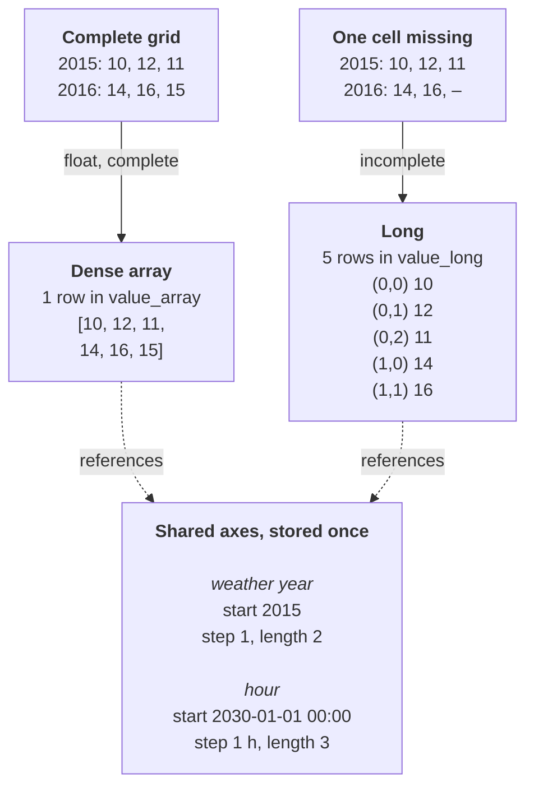

# Design rationale: value storage

This page explains how nodal-db stores parameter values and why: which
alternatives were considered, what was chosen, and what the choice costs
and buys in performance. It is written for contributors, for integrators
deciding how to read and write data, and for evaluators who want to know
what to expect at scale.

The page covers the reasoning. For what the tiers are, see
[Storage tiers](../features.md#storage-tiers). For the write pipeline
and module layout, see [Architecture](architecture.md).

Performance figures on this page are measurements under stated
conditions, not guarantees. Where a statement is a judgment rather than
a measurement, the text says so.

## In brief

- **Three storage tiers, chosen by the core from the data.** Values with
  no index are scalars. Float values on a complete grid are dense
  arrays: one row per value holding one flat list of numbers, with
  coordinates computed from shared axes instead of stored per cell.
  Everything else is long format, one row per cell. Readers see the
  same long format whichever tier holds a value.
- **Why dense arrays:** complete float series, such as hourly profiles
  and model results, are the bulk of the data. Storing them as one list
  per value avoids per-cell keys and per-cell rows when writing and
  bulk-reading them.
- **Whole versus partial reads:** on DuckDB 1.5.5, reading one cell or a
  time window of a dense array costs the same as reading the whole
  array, and that cost depends on how much list data is stored around
  the row, not on the array's length. Reading only an array's stored
  minimum and maximum takes well under a millisecond.
- **Writes are whole-value in every tier.** Changing one cell writes a
  complete new version of the value, and the old version is kept as
  history unless retention is switched off.
- **Still open:** a like-for-like comparison of dense-array and long
  storage, including when long rows are the faster choice, is waiting
  for a reproducible benchmark (see
  [Performance in principle](#performance-in-principle)).

## The problem

A parameter value in nodal-db can be:

- a single number, flag, string or timestamp,
- a time series, for example 8 760 hourly values for a year,
- a map keyed by labels or integers,
- a combination of up to four dimensions, for example weather year ×
  hour, or forecast × issue time × lead time.

Value kinds are `float`, `int`, `bool`, `string` and `date_time`. Sizes
range from one number to millions of cells per parameter: a model result
of 1 000 entities × 8 760 hours is 8.76 million values for one parameter.

The storage has to meet these requirements at the same time:

- **Readable with plain SQL.** Any DuckDB client must be able to query
  values without a nodal-db library.
- **Fast bulk reads.** A model loads whole parameters at once and should
  not pay per-cell overhead for dense time series.
- **Append-only history.** Every change is a new version tied to a
  commit; old versions remain readable with as-of queries.
- **One canonical form.** The same logical value must always produce the
  same stored rows and the same canonical encoding, whoever writes it,
  so that history diffs, equality
  checks and axis sharing work.

## Options considered

### Opaque encoded value per row

Each value is serialized into one column (for example as JSON or a
binary container) and decoded by the application. The Spine database
schema, which much of nodal-db's data model is based on, stores
parameter values as one encoded value column with a separate type
column.

- **For:** one simple table for all shapes; any value shape fits; a
  value is read or written as a unit.
- **Against:** the database engine cannot see inside a value, so SQL
  cannot filter, join or aggregate on individual cells. Reading any part
  of a value means fetching and decoding all of it (on DuckDB 1.5.5,
  nodal-db's dense arrays have the same read cost; see
  [Performance in principle](#performance-in-principle)). Canonical encoding
  and equality become the job of every application that writes values,
  and independent encoders can drift apart.

nodal-db does not use this approach: values are stored in typed columns
that the engine understands.

### One row per cell for everything (long format only)

Every cell is a row carrying its keys, its coordinates and its value.

- **For:** fully relational; handles any shape, sparse or dense, and any
  value kind; a filter on a coordinate is an ordinary `WHERE` clause.
- **Against:** dense series pay per-row overhead on every cell, in
  storage, write time and read time. In nodal-db's own measurements
  (see [Measured figures](#measured-figures)), long-format writes are
  about 50 times slower per value than dense-array writes, and returning
  8.76 million cells in long form takes seconds rather than a few
  hundred milliseconds. These figures come from nodal-db's long tier,
  which also carries history columns, uniqueness indexes and per-cell
  versions, and from read views that compute every cell's coordinates.
  A long-only design without those would measure differently; see the
  note in [Performance in principle](#performance-in-principle).

### One dense array for everything

Every indexed value is a rectangular array.

- **For:** compact and fast for dense numeric data.
- **Against:** sparse or ragged data has to be padded with missing-value
  markers or encoded raggedly inside the array, and non-numeric values
  fit poorly. With sparse data, a dense layout spends storage and memory
  on cells that do not exist, and the missing-value markers can reach
  computations if a reader does not skip them.

### Chosen: three tiers, picked automatically from the data

nodal-db combines the two native representations and adds a third for
the common case of a single value:

| Tier (`tier` value) | Holds | Layout |
|---|---|---|
| Scalar (`scalar`) | values with no index | one value |
| Dense array (`array`) | float values on a complete grid, 1–4 dimensions | one flat list of numbers against shared axes; coordinates come from the axes |
| Long, row-per-cell (`long`) | everything else: incomplete grids and non-float values, 1–4 dimensions | one row per cell, each with its own coordinates |

The reasoning: sparse data is naturally stored as records, dense data
as arrays, and a store that serves both well needs both natively.
Choosing between them is a physical storage decision, so it is hidden
from readers: every read view and macro presents the same long format.

### Smaller decisions within the chosen design

| Question | Decision | Why |
|---|---|---|
| Who picks the tier? | The core, from the data. Callers cannot. | The same data must always land in the same form; otherwise history diffs and equality checks break between writers. |
| One table per value kind (float, int, string, …)? | No. One table per tier, with typed columns (and a `value_kind` tag on the scalar and long tables). | Per-kind tables would multiply the tables every read view must combine. Judgment, not measured: little would be gained, because mostly empty typed columns compress to almost nothing in a columnar store. |
| Split very long arrays into chunks? | No, one row per value. | DuckDB already splits list data into storage blocks, so chunks are not needed for storage. They would not make history cheaper either, because every write replaces the whole value. See [Chunks and partial versioning](#chunks-and-partial-versioning). |
| Deduplicate identical arrays? | No (identical *axes* are deduplicated). | Each value row belongs to exactly one entity, parameter and alternative. Sharing one profile between many entities can be modelled explicitly instead, for example as a profile on a shared entity scaled by a per-entity factor. |
| History of dense arrays: in the same table or separately? | Separately: `value_array` holds current rows only; superseded rows move to `value_array_hist`. Scalar and long values keep history in the same table. | Superseded arrays can be megabytes each. Keeping them out of the current table means bulk reads of current data never scan them. Superseded scalar and long rows are narrow and are only marked as closed, never copied. |
| Dense arrays of integers? | Not yet. Integer values use the long tier. | Dense numeric float data is the main performance case. The schema has a reserved integer-list column on `value_array` that the read views already understand, but the core does not write it yet. |

#### Chunks and partial versioning

Splitting an array into chunks would not, by itself, let an edit store
only the chunk it changed. Today every write replaces the whole value:
the write API takes whole values, the canonicalization pipeline derives
the axes and the tier from the whole value, and the history model gives
one version number to each value. With chunks, an edit would still
rewrite every chunk.

Versioning chunks separately is not implemented. It would need:

- a chunk number in the key of `value_array` and `value_array_hist`,
  with version numbers counted per chunk, and history checks and the
  value timeline changed to match;
- a chunk size fixed as part of the canonical form, so that the same
  data always splits the same way; existing arrays would have to be
  converted to it;
- read views that join the chunks of a value back together, in order;
- a write path that compares the new value with the stored one to find
  the changed chunks, which means reading the stored array first;
- per-array minimum and maximum computed across chunks.

Even then it would apply only to edits that keep the axes and the tier
unchanged. Adding or removing a coordinate changes the derived axes,
and with them every chunk; removing one cell of a multi-dimensional
value moves it to the long tier. As-of reads would need no new idea:
they already select each row by its own commit span.

For comparison, the long tier already counts versions per cell in its
schema, but its write path still closes out and re-inserts every cell
of a value on each write.

## How the chosen design works

### The tier rule

After the canonicalization pipeline has dropped NULL cells, derived the
axes from the data and sorted the cells, the core applies one rule:

- no index → **scalar**;
- one or more dimensions, `float` values, and every combination of the
  axis coordinates present → **dense array**;
- otherwise → **long**.

Two consequences follow from deriving the axes from the data:

- **A one-dimensional float series is always a dense array.** Its axis
  is exactly the set of its own coordinates, so it is always complete.
  A series with gaps gets its own irregular axis instead of moving to
  the long tier.
- **From two dimensions up, one missing cell moves the whole value to
  the long tier.** A 3 × 8 760 grid with one hole is stored as
  26 279 long rows. Readers do not see the difference, but storage and
  write cost do (see below).

Example: a demand profile given for two weather years (2015 and 2016)
over the first three hours of the model year 2030, once complete and
once with one cell missing. Rows are weather years, columns are hours
00:00, 01:00 and 02:00:

The dense array stores its cells in row-major order: the last dimension
varies fastest. The long rows store each cell's position on each axis;
for time and integer dimensions they also carry a copy of the
coordinate to speed up filtering.

### Shared and parametric axes

An axis is a separate, immutable object that values point to. Two
properties make axes cheap:

- **Parametric form.** A regular axis, such as every hour of a year, is
  stored as start, step and length: three numbers, however long the
  axis. Coordinates are computed when read (start + position × step).
  Only irregular axes store one row per coordinate.
- **Sharing.** Axes are content-addressed: an axis identical to an
  existing one is reused. Every hourly series for the same year points to
  the same axis row.

As a result, a dense array stores no timestamps at all, and a thousand
hourly series on the same year share one three-number axis. Long rows
point to the same axes.

### Canonical form

Before the tier decision, every value goes through one canonicalization
pipeline in the core, and axes and values have a fixed byte encoding.
Because the tier is a deterministic function of the canonical content,
the same data always ends up in the same tier with the same canonical
encoding. This
is what allows equality checks, axis deduplication and diffs across
history without comparing values cell by cell in application code.

### One read shape, two read paths

- `read_parameter`, `value_rows` and `value_cells` return every tier as
  long rows. Dense arrays are expanded into one row per cell inside the
  query.
- `read_parameter_dense` returns dense arrays as they are stored: one
  row per value with the list of numbers and the axis ids, plus the
  minimum and maximum of each array. The client computes coordinates
  from the axes. This is the fast path for bulk reads.

## Performance in principle

`n` is the number of cells in the value.

The table describes how each tier works; it is not a ranking of the
two. A like-for-like comparison of dense-array and long storage (read
and write speed, file size and memory, and the cases where each is
faster) needs a reproducible benchmark that runs both layouts on the
same data and DuckDB version. That benchmark is being prepared, and the
comparison will be added here from its results.

| Operation | Dense array | Long |
|---|---|---|
| Read a whole value | One row and one list of `n` numbers. No per-cell keys. Through `read_parameter_dense` or `value_cells` the list is fetched by its `array_id` with an index scan (about 2.4 ms for one 8 760-value array in the `array_id` measurements below). A read that scans the table instead pays a fixed cost set by how much list data is stored, not by `n` (77 ms in Set A below, measured before the `array_id` key existed). | `n` rows, each with keys, positions and a value. |
| Read a slice (a time window, or one index of a multi-dimensional value) | Costs the same as reading the whole value (see below). | A filter on positions or coordinates over the value's rows. Not benchmarked separately. |
| Read one cell | Same as a slice. | About 1 ms in the benchmark gate. |
| Write a new value | One row, but the list is currently passed as one SQL parameter per cell, which dominates the cost. | `n` rows, written in batched multi-row inserts. |
| Change one cell | The whole value is rewritten: the old row (all `n` cells) is copied to `value_array_hist` and the current row is replaced. | The whole value is rewritten: all `n` current rows are closed out (marked, not copied) and `n` new rows are inserted. |
| History growth per change | About one extra copy of the value. | About one extra copy of the value, at long-format row size. |
| Effect of history on current reads | No effect on scans of current data: superseded arrays live in a separate table. The file grows (see below). | Small: closed-out rows share the table. Measured scan slowdown 1.41× with 18–33 % of rows closed out. |

Notes on the table:

- **Slices of dense arrays are not cheaper than whole reads.** This was
  measured: slicing in SQL (`values[a:b]`), unnesting and filtering, and
  fetching the whole list and slicing in the client all cost the same.
  DuckDB does not skip parts of a list column. A query that reaches the
  list through a sequential scan (a filter on the key triple directly
  on `value_array`, or more than 50 values at once) pays for scanning a
  large part of the stored list data, whatever the size of the slice;
  smaller row groups did not reduce this in the tests. Reads through
  `read_parameter_dense` and `value_cells` fetch the row by its
  `array_id` with an index scan instead, so a slice costs about what a
  whole value costs, a few milliseconds. Reading only the per-row
  minimum and maximum, without touching the list, takes well under a
  millisecond.
- **Every write replaces the whole value.** The write API takes whole
  values; there is no per-cell update. Writing a value identical to the
  current one also creates a new version. Callers that want to avoid
  this should compare before writing.
- **History can be kept without content.** When the parameter
  definition has `retain_content` set to false, or with the
  `force_replace` write option (or `retain_override` set to false), the
  superseded version is kept only as a stub: its version and commit edges remain, its payload
  does not. This suits regenerated data such as model results.
- **Storage size.** DuckDB compresses column data automatically; how
  much depends on the data. A dense array stores eight bytes per float
  before compression and no per-cell keys. A long row carries keys,
  positions and typed value columns, and the long table carries indexes
  that enforce one current row per cell. Many small commits leave the
  file fragmented; [compaction](../features.md#compaction) repacks it.
- **Memory on read.** A read returns whole values. Through
  `read_parameter_dense`, a dense array arrives as one list of `n`
  eight-byte floats plus a few ids, and the client holds the whole list
  even when it needs only part of it. Through `read_parameter` and the
  other long-form views, every cell becomes a row with the entity and
  alternative names, the tier and value kind, twenty index columns and
  seven value columns, most of them empty. That takes many times more
  client memory per cell than the list form; for large parameters, read
  dense values through `read_parameter_dense`.
- **Very long series.** A dense array is one row however long it is.
  The core holds the whole value in memory while canonicalizing and
  writing it, in a working form several times larger than its eight
  bytes per cell. The array is inserted as one SQL statement with one
  parameter per cell, so a one-minute series for a year means an insert
  with about 525 600 parameters. That statement's cost grows with `n`:
  about 22 ms per 8 760-value series in Set B; longer series were not
  measured. Every edit, even of one cell, rewrites the whole array and,
  with retention on, copies the old one to history.
- **History growth and read speed.** Reads of current dense arrays use
  `value_array` only, so a growing `value_array_hist` does not slow
  them down. As-of reads combine both tables and pay for scanning the
  history table's list data as well, so they slow down as history grows
  (expected from the mechanism above, not measured). The file also
  grows with history, and opening the file costs more as it grows: in
  Set B, opening an 805 MiB file took about 20 ms and a 1.6 GiB file
  about 107 ms. Each read opens and closes its own connection, so it
  pays this cost. Turning retention off for regenerated data, and
  [compaction](../features.md#compaction), limit the growth.

## Measured figures

Two sets of measurements, both on DuckDB 1.5.5 and taken before the
`array_id` key existed, so their dense-array point and slice reads show
the old sequential-scan cost; the `array_id` measurements follow Set B.
Absolute numbers depend heavily on the machine; compare within a set,
not across sets.

**Set A, the benchmark gate** in the repository
([`benches/RESULTS.md`](https://github.com/nodal-tools/nodal-db/blob/main/crates/nodal-db-core/benches/RESULTS.md)).
Intel Core i3-6100, SATA SSD. Synthetic database written through the
core: 1 000 dense arrays of 8 760 floats (about 70 MB of payload),
1.23 million long rows, 100 000 scalars; 213 MB on disk. Reads use a
warm connection and include conversion to Arrow.

| Operation | Measured |
|---|---|
| One scalar value | 0.98 ms |
| One long cell | 0.98 ms |
| One whole dense array (8 760 values) | 77.3 ms |
| One dense array's minimum and maximum only | 0.56 ms |
| All 1 000 arrays as lists (`read_parameter_dense`) | 311.5 ms |
| All 1 000 arrays as long rows (`read_parameter`, 8.76 million rows) | 7 351 ms |
| 1.23 million long rows, long form | 2 063 ms |
| Write one dense array (end to end, during the bulk build) | 82 ms |
| Long-tier write, 8 760 cells, after batching (micro-benchmark) | 0.24 ms per cell (first write), 0.28 ms per cell (replace) |
| Replace one 8 760-cell dense array, including checkpoint and reopen | 2.43 s |
| Replace one scalar, including checkpoint and reopen | 1.24 s |

The two replace cycles show that, at this file size, about half of an
array replace cycle is the commit's fixed cost (checkpoint and reopening
the file, which dominate the scalar cycle); the other half is writing
the new array and copying the old one to history.

**Set B, results-scale data**, from
[`crates/nodal-db-cli/benches/results_path.rs`](https://github.com/nodal-tools/nodal-db/blob/main/crates/nodal-db-cli/benches/results_path.rs)
(`just bench-results`; full results in
[`scripts/bench/RESULTS_results_path.md`](https://github.com/nodal-tools/nodal-db/blob/main/scripts/bench/RESULTS_results_path.md)).
AMD Ryzen 9 5900XT, NVMe
SSD. Ten parameters × 1 000 entities × 8 760 hourly floats (87.6 million
values) with random full-precision values, chosen to be hard to
compress, like solver output.

| Measurement | Result |
|---|---|
| Dense-array ingest, one commit | about 280 000 values/s |
| Long-tier ingest (876 000 integer cells) | about 5 400 values/s, about 50× slower per value |
| Share of dense-array write time spent parsing and binding the insert statement, which carries one parameter per cell | about two thirds (about 22 ms per 8 760-value series) |
| File size, 8.76 million dense values in one commit | 71.5 MiB (about 8.2 bytes per value, net of the empty schema) |
| File size, same data written in 10 commits | 127 MiB, before compaction |
| File size, 876 000 long cells in one commit | 79 MiB (about 91 bytes per cell net, including indexes) |
| One week (168 values) from each of 20 year-long series | about 110 ms warm, 220 ms with a fresh connection (opening it not included) |
| The same week, through `read_parameter` with a timestamp filter | about 245 ms warm |
| Reading one whole series, or one week of it | about 116–120 ms either way |

In Set B all 10 000 arrays fell into one storage row group, and reading
one week of 20 series cost the same as reading one whole series: both
scan the stored list data rather than only the requested cells.
Rebuilding the table with smaller row groups did not help in that test.

The dense and long rows in Set B hold different data (random floats
against integers on every tenth hour), so the per-value size comparison
is indicative only.

**The `array_id` key, before and after.** The Set B data and harness,
ingested through the Arrow-IPC import lane into one file per schema and
read with the bundled DuckDB 2.0.0, on the same AMD Ryzen 9 5900XT host
(shared with other jobs, load average about 2 to 8). Warm minimum over
15 reads; "cold" is a fresh connection with opening excluded.

| Read | Before (composite key) | After (`array_id`) |
|---|---|---|
| One whole series, `read_parameter_dense` | 84.8 ms (cold 182 ms) | 2.4 ms (cold 6.1 ms) |
| One week of one series, or one cell | 85.0 / 84.9 ms | 2.4 / 2.5 ms |
| One week from each of 20 series, `read_parameter_dense` | 86.5 ms | 3.6 ms |
| The same through `read_parameter` with a timestamp filter | 2 751 ms | 2 946 ms |
| One series' minimum and maximum only | 2.0 ms | 2.3 ms |
| Import of the 87.6 million values, one commit | 1 200 s | 1 187 s and 1 219 s (two runs) |

The `read_parameter` path does not use the index yet and became a few
per cent slower; a paired, interleaved comparison of the whole-parameter
`read_parameter` read (one process, one file, 21 pairs) put the cost at
4.1 % (median ratio 1.041, 95 % bootstrap interval 1.003 to 1.059). A
read of more than 50 series at once falls back to scanning the list
data (51 series: 88 ms). The file grew by 256 KiB (0.04 %).

## Known limitations and open directions

- **Point and slice reads of dense arrays.** Through
  `read_parameter_dense` and `value_cells` they are index lookups by
  `array_id` (about 2.4 ms for one 8 760-value series in the `array_id`
  measurements above). Some reads still scan the list data of the whole
  table, at the old cost (about 90 ms there): a read of more than 50
  values at once, a read of a value that does not exist, a filter on the
  key triple applied directly to `value_array`, and point reads through
  `read_parameter`, `value_rows` and `value_array_asof`. A fast path for
  those is planned. The index lookup depends on DuckDB's planner
  heuristics, so a test checks the plan shape on every build.
- **Dense-array write speed.** Each array is inserted with one SQL
  parameter per cell. Batching array inserts, as was already done for
  the long tier (about 12× faster there), is the identified next
  improvement; it is not implemented yet.
- **Long-tier write speed.** Even after batching, long-tier writes are
  much slower per value than dense-array writes. Large result sets are
  best kept dense: complete grids of float values.
- **Edits rewrite whole values.** Changing one cell creates a full new
  version, in either tier. There is no per-cell history.
- **The two-dimensional tier cliff.** One missing cell in a
  multi-dimensional float value moves the whole value to the long tier.
- **Integer grids use the long tier.** The reserved integer-list column
  is not written by the core yet.
- **Irregular one-dimensional series create their own axes.** Each gappy
  series gets an axis matching its own coordinates. Unused axes are not
  removed: compaction keeps all axes, and there is no axis clean-up yet.
