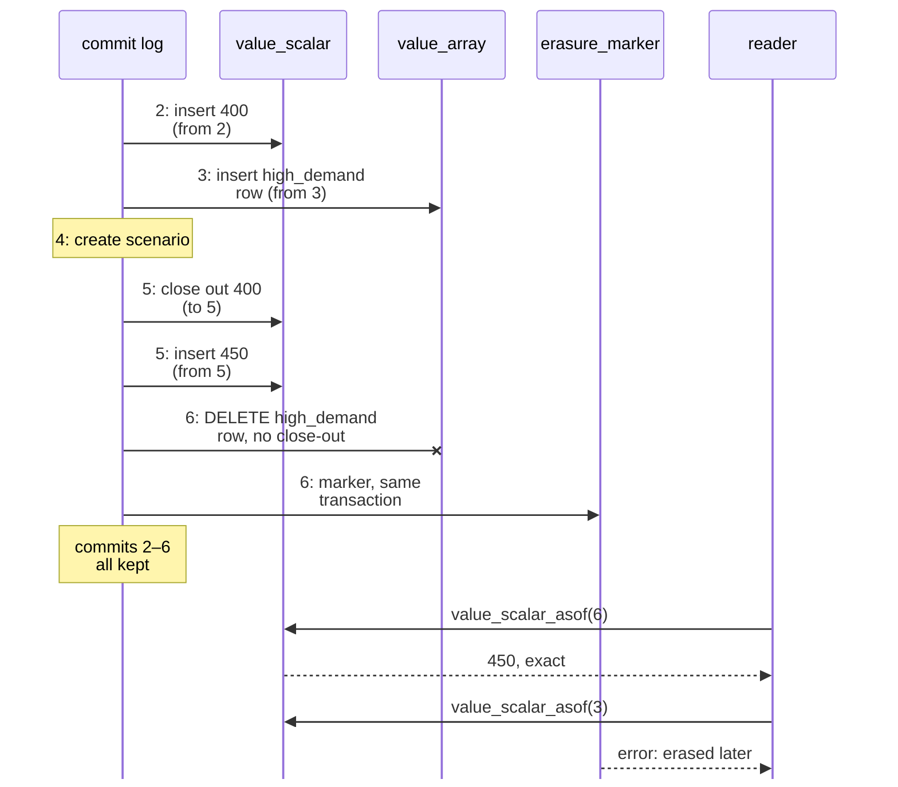

# Features

This page is a tour of what nodal-db does. Features that are planned but
not implemented are marked **Planned**. The examples use names from
energy-system modelling (`node`, `unit`, `demand`), nodal-db's first use
case; the structures themselves are generic. For commands and code, see
[Using nodal-db](usage.md).

## Entity classes and entities

Data is organized into **entity classes** (`node`, `unit`) and their
**entities** (`north`, `coal_plant`). A class can be N-dimensional: a
class such as `unit__node` with dimensions `[unit, node]` has entities
that are tuples of entities from other classes. This is how relationships
such as "unit feeds node" are modelled.

Entities can also be grouped (membership), and each entity can be
switched on or off per alternative (activation). Both are resolved per
scenario in SQL. The table macros `scenario_contents(scenario)` and
`scenario_diff(a, b)` show the result.

**Why:** a single, generic structure covers model topology without a
table per object type, and the same structure works for any model.

## Alternatives and scenarios

Every value belongs to an **alternative**, a named layer of data such as
`Base` or `high_demand`. A **scenario** is an ordered list of
alternatives. To resolve a scenario, nodal-db takes, for each
(entity, parameter), the value from the highest-ranked alternative that
has one. The whole value wins or loses as a unit.

Resolution happens in views:

- `resolved_value_rows(scenario)` returns the winning values in long form.
- `scenario_value_conflict` lists every (entity, parameter) for which
  more than one alternative in a scenario has a value, before resolution.
  Editors can highlight these; nothing is blocked.

**Why:** variants are stored as small overlays instead of copies of the
whole data set, and how a scenario was assembled is always inspectable.

## Parameter values

A parameter value can be a scalar, or an indexed value with up to four
dimensions: a time series, a map keyed by labels, or a combination such
as scenario × time.

| | Supported |
|---|---|
| Value kinds | `float`, `int`, `bool`, `string`, `date_time` |
| Index kinds | `datetime`, `integer`, `label` |
| Maximum rank | 4 |

`NULL` means absent: a NULL cell is dropped rather than stored. `NaN` is a
valid stored value but never a valid index coordinate.

Duration values and `period` / `time_pattern` index kinds are part of the
schema but cannot be written yet; they are reserved for a later version
of the import format.

Parameter definitions can declare the types they accept, default values,
value lists (enumerations) and units. Units are stored and carried along
with values but never converted.

### Storage tiers

Internally, the core stores each value in one of three storage **tiers**:

| Tier (`tier` value) | Holds | Layout |
|---|---|---|
| Scalar (`scalar`) | values with no index | one value |
| Dense array (`array`) | float values on a complete grid, 1–4 dimensions | one flat list of numbers against shared axes; coordinates come from the axes |
| Long, row-per-cell (`long`) | everything else: incomplete grids and non-float values, 1–4 dimensions | one row per cell, each with its own coordinates |

"Long" refers to long format: one row per cell, each carrying its own
coordinates. Both the dense array and the long tier hold values with
one to four dimensions; what separates them is completeness and value
type. A grid is complete when every combination of the coordinates that
occur in the value has a cell. Because the axes are derived from the
data, a one-dimensional float series is always complete over its own
axis, so it is always stored as a dense array, even when its time steps
are irregular. Integer, boolean, string and date-time values use the
long tier, even on a complete grid. The tables are `value_scalar`,
`value_array` and `value_long`.

The core decides the tier from the data. Callers never choose it, and
readers never see it: every read macro returns the same long format
whichever tier the value is stored in.

**Why:** dense hourly series are stored compactly and read fast, while
sparse and mixed data keeps a simple row layout, behind one read shape.
The trade-offs behind this split are explained in
[Design rationale: value storage](dev/design_rationale.md).

## Canonical encoding and shared axes

Before anything is stored, the core runs every value through one
**canonicalization pipeline**:

1. NULL elimination: NULL and an omitted cell mean the same thing.
2. Axis derivation: index axes are derived from the data. Regular
   progressions, such as an hourly time axis, are stored in parametric
   form (start, step, count).
3. Row-major sort in the declared dimension order.
4. Tier decision.

Axes are content-addressed: identical axes are stored once and shared.
The byte encoding and hash (XXH3-64) are fixed: a given value always
encodes to the same bytes. A language-neutral conformance suite
([`conformance/`](https://github.com/nodal-tools/nodal-db/tree/main/conformance)),
checked against an independent Python implementation, verifies that the
output is reproduced exactly.

**Why:** the same data always produces the same bytes, whoever writes it.
History diffs, axis sharing and equality checks depend on this. The
project's founding lesson is that two independent canonicalizers drift,
so there is exactly one.

## Commits and append-only history

Every write, whether values, structural changes, deletions or a template
load, is one atomic **commit** with an author, a message and a timestamp.
The `commit` table is append-only.

Mutable rows carry `valid_from_commit` and `valid_to_commit`. An update
**closes out** the current row by setting `valid_to_commit` and inserts a
new row with a higher `version`. Deleting a value or an object closes it
out the same way. For dense-array values, the previous row is copied from
`value_array` to a `value_array_hist` table in the same transaction,
keeping its `array_id` row handle. History is never rewritten.

Writing a value equal to the stored one changes nothing: no new version
and no history row. A call that changes nothing at all creates no
commit (its report has commit id 0).

Long-format values keep **cell-level history**. When a long value is
rewritten on the same axes, with the same value kind and parameter type,
only the cells that changed or disappeared are closed out, and only the
changed and new cells are inserted; the other cells keep their row and
their version. Editing one cell of a 4.6 million-cell value writes one
row, not 4.6 million. A rewrite on other axes (a coordinate added to or
removed from a derived axis), with another value kind or another
parameter type replaces every cell, as before. As-of reads are exact
either way, because every row carries its own commit span.

Audit views check that history is consistent, for example
`audit_history_tiling` for version continuity.

**Why:** every value in the database can be traced to the commit that
wrote it and the commit that replaced it, without separate change logs.

## As-of reads

For each versioned table there is a table macro `<table>_asof(c)` that
returns the table as it was at commit `c`: `value_scalar_asof`,
`value_long_asof`, `value_array_asof` (current rows plus `_hist`),
`entity_asof`, `alternative_asof`, `parameter_definition_asof` and so on.
`value_timeline` lists every version of every value across all tiers.
For a long-format value a version is a *change span*: a new span starts
at every commit that changed any of its cells, a deletion leaves a gap,
and `content_retained` is false when any cell valid in the span was kept
only as a stub. `history_untrusted_span` lists the spans whose content
was not retained.

**Why:** you can reproduce exactly what a model run saw, or compare the
current data with any earlier state, using SQL.

## Erasure with markers

Some data has to be physically removed, for example the results of a
model run that has been superseded by a rerun. nodal-db supports this in
exactly one way: **erasing an alternative**
(`nodal-db erase-alternative`, or `erase_alternative` in Python and
Rust). In one transaction, the erase:

- deletes every row keyed to that alternative, current or superseded:
  its values in all tiers, and its scenario-ranking, activation and
  membership rows,
- closes out the alternative itself,
- writes an `erasure_marker` row that records the commit, the number of
  rows removed and an optional note.

Removed rows carry no close-out edge; the marker is their trace. The
`commit` log is never touched. Every as-of macro checks the markers: a
read at a commit earlier than the newest marker raises an error instead
of silently returning incomplete data. `audit_erasure` lists the markers
with who erased what and when. A `--preview` mode reports what would be
removed without changing anything.

Erasure is intended for output databases where results are overwritten
on rerun. The CLI prints a warning when the target database has no `run`
provenance rows, because that suggests a curated input database.
Alternative-level erasure is the only way rows are removed from a
database. To get rid of old history, a
[history-free extract](#history-free-extract) writes a new file and
leaves the original untouched. Other erasure scopes, including pruning
history in place, are **Planned**.

The diagram follows the example in [Using nodal-db](usage.md); the
number on each arrow is the commit that performs it. The update
at commit 5 does not overwrite the 400 row; it sets that row's
`valid_to_commit` to 5 and inserts a new row. Before commit 6, an as-of
read at commit 3 would return 400. After the erasure at commit 6, any
as-of read at a commit before 6 fails, because content that existed then
has been removed. Reads at commit 6 or later are exact.

## Compaction

DuckDB never shrinks a database file on its own. The core's compaction
rebuilds the file into a fresh, densely packed copy, verifies the full
content, and atomically swaps it in. All history, commits and axes are
preserved; space freed by erasure is returned to the operating system at
this point. The `audit_health` view reports dead-row fractions and
advises when compaction is worthwhile.

Compaction is available from the CLI (`nodal-db maintain compact`, with
`--if-needed` to compact only when the file has grown past a threshold or
enough commits have landed since the last compaction), from Python
(`Database.compact()`) and from the Rust API (`compaction::compact`,
`compaction::compact_if_due`).

## History-free extract

Compaction keeps every row. A database with a long history can be much
smaller without it: a **history-free extract** writes a new database file
that holds exactly the content valid at one commit, without the
superseded versions (`nodal-db extract`, `Database.extract` in Python,
`extract::extract` in Rust). The source file is only read. It keeps the
complete history and serves as the archive.

The extract holds:

- the `commit` log up to the extracted commit, unchanged, plus one new
  commit of its own (the *extract commit*);
- every row that was current at the extracted commit, with its version
  number and commit stamps unchanged;
- only the axes that the carried values use;
- all earlier erasure markers and `run` rows;
- the closed identity rows of alternatives and entities that a carried
  `run` row or marker refers to, so those references still resolve.

The extract gets its **own database identity**. In its extract commit it
records a `kind='horizon'` erasure marker that names the source's
identity (`continuation_db`) and the extracted commit
(`horizon_commit`). Like any erasure marker, it makes as-of reads at
commits before the extract commit fail loudly in the extract: the
history behind them lives in the source. Reads at the extract commit or
later are exact. `audit_history_tiling` accepts version numbers that
start above 1 for values that existed at the horizon, and checks
everything written afterwards as usual. The extract is an ordinary
database: writes, erasure, compaction and further extracts all work on
it.

`--as-of N` extracts the state as it was right after commit N instead
of the current state. It is refused when N is not a commit, when an
erasure marker was written after N (content valid at N was removed
later), or when some content valid at N was not retained (a history
stub). Rows that were current at N but closed later are carried as
current rows: their closing commit lies outside the extract's history,
so it is cleared (version numbers and starting commits stay unchanged).
`run` rows have no creation commit, so an as-of extract keeps
the runs whose input and output commits are at or before N and whose
alternative and tool entity existed at N.

The extract refuses to overwrite an existing file, refuses a destination
that has a leftover `.wal` file, and never writes the source. While it
copies, it holds the source's lock, so writers to the source wait or get
a `Busy` error, as during compaction.

**What it buys:** mainly file size, for sharing, backup and input/output.
Measured against a *compacted* copy of the same source (compaction alone
already reclaims the space of old checkpoints), the gain is the dropped
history. In the benchmark (90 % of the array data superseded) the
extract was 2.6 times smaller than the compacted source, and 4.4 times
smaller than the uncompacted one. A fixed per-file overhead and the live
data remain, so the gain stays well below what the dead fraction alone
suggests. It does not make array point reads faster,
and it barely changes the time to open a file compared with a compacted
file. No speed-up of current-state scans is claimed.

## Provenance

The `run` table records model runs: which tool ran, the input commit it
consumed, the alternative its outputs were written to, the solver, tool
version, status and so on. It is append-only. Every database also has a
stable identity UUID, minted at creation and kept through compaction,
which output databases can use to refer to their input database. A
history-free extract is a new database and gets a new identity; its
horizon marker names the identity of the database it came from.

The core does not yet provide a dedicated API for writing `run` rows;
that is **Planned**.

## Completeness and audit views

Validation in nodal-db is reported, not enforced by blocking writes. The
schema includes views that report problems as rows:

- Completeness: `audit_missing_required_value`, `audit_required_class_empty`,
  `audit_scenario_empty`.
- Integrity: `audit_dangling_ref`, `audit_type_conformance`,
  `audit_value_list_membership`, `audit_axis_integrity`,
  `audit_membership_cycle` and others.
- History and maintenance: `audit_history_tiling`, `audit_erasure`, and
  `audit_health`, a one-glance summary of live versus dead rows and file
  size.

**Why:** incomplete data is normal while a model is being built. Reports
let editors and tools show what is missing without refusing to save work.

## Structural changes and deletion

Besides values, the core API writes structure: creating and renaming
alternatives and scenarios, setting a scenario's alternative ranking,
setting entity activation and group membership, and creating entities,
classes and parameter definitions. Values, structural changes and
deletions can be combined into **one commit** (`commit_changes`), which
is what an editor save needs.

Deleting an object (alternative, scenario, parameter, entity or class)
closes out the object and its dependents. A preview reports what would be
affected, and deletion can either cascade or refuse when dependents exist.

Names that a write refers to but that do not exist yet are created
automatically, and each creation is reported as a machine-readable
warning.

## Arrow-IPC bulk import

`nodal-db import` reads a file in the Arrow-IPC bulk format: one or more
Arrow IPC streams concatenated in a file, each stream targeting one
(class, parameter) pair. Any language with an Arrow library can produce
it. The whole file is imported in one commit, and any error leaves the
database untouched. The importer checks that each stream is complete,
so a truncated file is rejected rather than partially imported.

The format (version 1.0) is described in
[Arrow-IPC import format](dev/arrow_import_format.md).

**Why:** tools written in languages without nodal-db bindings get a
complete write path that still goes through the one canonicalizer.

## Templates

A **template** is a YAML or JSON document that declares a model's
vocabulary: classes and their dimensions, parameter definitions with
types, defaults and units, value lists and parameter groups. The CLI can
load a template into a new database (`init --template` or
`template load`), show what reconciling a database to a newer template
version would do (`template plan`), apply it (`template apply`), and
export a database's vocabulary back to a template (`template export`).

Template versions can chain migration steps. Steps that need custom code
are registered by the tool that owns the template; the Python skin
accepts plain Python functions for this.

## Python skin

`nodal_db` is a Python package built from the core with PyO3. It passes
Arrow data (pyarrow, or anything that implements the Arrow PyCapsule
interface, such as polars) in and out, and translates core errors into
Python exceptions (`nodal_db.Busy`, `nodal_db.Conflict`,
`nodal_db.ApiError`, …). A `Database` handle holds only the file path;
every method opens and closes its own connection.

The package is built from source with `maturin` (see
[Build](usage.md#build)); published packages, when available, are listed
on the [Releases page](https://github.com/nodal-tools/nodal-db/releases).

## Spine database import

The `nodal_spine_import` Python package (in `python/` in the repository)
imports a Spine Toolbox database (read through `spinedb_api`) into a new
nodal-db database. It writes through the Python skin, declares parameter
types from the shapes of the values actually found, and reports
everything it could not import instead of dropping it silently.
Tool-specific details, such as the template name and how to name index
dimensions, are supplied by a small `Profile` subclass.

## Concurrency

nodal-db has a single-writer model. Writes are serialized, within a
process by a per-file lock and across processes by DuckDB's file lock.
Contention is reported as a defined `Busy` or `Conflict` error after a
bounded retry, not as a hang. Readers detect new data by polling the
newest commit id. See
[connection discipline](usage.md#connection-discipline).

## Editor

A graphical editor built with egui is **in development** in a separate
repository. It reads through the SQL views and writes through the core
API.
