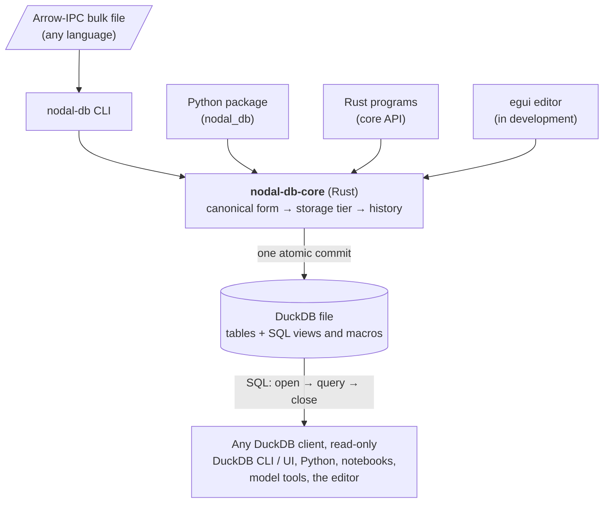

# nodal-db

nodal-db is a general-purpose database format for structured, versioned
data. It is designed for modelling: model inputs, alternatives and
scenarios, and aggregated outputs. Its features may also suit other
kinds of structured data. Everything lives in a single
[DuckDB](https://duckdb.org) file. Every write goes through one Rust
core, which stores each value in a single deterministic form and keeps the
history of every change. Anyone can read the file with plain SQL.

## The problem it addresses

Modelling usually needs a lot of structured data. That data has to
describe:

- the things being modelled and the relationships between them;
- parameters of many shapes: single numbers, time series, and
  multi-dimensional data indexed by several labels or times at once;
- alternative versions of the data that combine into scenarios.

The same data is often edited by people, generated by scripts, and
consumed by several tools. Users need to know what changed, when and by
whom, to reproduce what a past run saw, and to read the data with
standard tools rather than a dedicated library.

nodal-db provides one storage model for all of this:

- **Entities and classes** — objects of any kind (for example `node`
  or `unit`) and N-dimensional relationships between them
  (`unit__node`). Classes are rows of data, typically declared by a
  template, not tables in the schema.
- **Alternatives and scenarios** — every value belongs to an alternative
  (a named layer of data, such as `Base` or `high_demand`); a scenario is
  a ranked stack of alternatives, resolved in SQL.
- **Parameter values of any shape** — scalars, time series and
  multi-dimensional indexed values up to rank 4, all read back in one
  long format.
- **History** — every write is a commit; a changed row is marked as
  superseded ("closed out"), not overwritten, so any past state can be
  read back.
- **Standard reading** — the database is an ordinary DuckDB file with a
  read interface of SQL views and macros.

## Key ideas

**One writer, one canonical form.** All writes go through
`nodal-db-core`, a Rust library. It brings every value into one canonical
(deterministic) form, decides how it is stored (scalar, dense array or
long rows — the storage *tier*), derives and deduplicates index axes, and
applies the history protocol, all inside one atomic commit. Callers never pick a storage
layout, and there is no second implementation of these rules to drift
out of sync.

**Append-only history with as-of reads.** Rows carry the commit that
created them and the commit that closed them out. As-of macros
reconstruct the database at any earlier commit. The one sanctioned form
of physical removal, erasure, always leaves an `erasure_marker` row, and
as-of reads that would cross removed content fail instead of returning an
incomplete answer.

**A DuckDB file anyone can read.** The database is an ordinary DuckDB
file. A set of SQL views and table macros (`read_parameter`,
`resolved_value_rows`, `*_asof`, `audit_*`) forms the read interface, so
any DuckDB client in any language can query it without special bindings.

**CLI and Python on top of the same core.** The `nodal-db` command-line
tool creates databases, bulk-imports Arrow-IPC files from any language,
manages templates and erases alternatives. A thin Python package
(`nodal_db`, built with PyO3) exposes the same core to Python. Neither
contains canonicalization logic of its own.

## Architecture

Every write path ends in the same core. Readers talk to the DuckDB file
directly through the SQL views and hold a connection only for the
duration of each query (see [Using nodal-db](usage.md#connection-discipline)).
The graphical editor is being developed in a separate repository; it
reads through the SQL views and writes through the core API like any
other client.

## History

nodal-db's first use case is planning-scale energy-system modelling,
which is where it comes from. Its examples, such as nodes, units and
demand series, come from that field, but nothing in the schema or the
core is specific to it.

nodal-db owes a lot to the Spine database schema, the data model of
[Spine Toolbox](https://github.com/spine-tools/Spine-Toolbox): entity
classes and N-dimensional entities, alternatives stacked into
scenarios, and parameter values of many shapes all follow its design.
nodal-db tries to remove some of that schema's limitations. For
example, parameter values are stored in typed tables that plain SQL can
read, rather than in an encoded form that needs a library to decode,
and every change is kept as append-only history with as-of reads of
earlier commits. The
[Spine importer](features.md#spine-database-import) converts an
existing Spine database into a nodal-db file.

## Status

The current state of the project is visible in its
[GitHub repository](https://github.com/nodal-tools/nodal-db):

- the [commit history](https://github.com/nodal-tools/nodal-db/commits/main)
  of the `main` branch;
- the [Releases page](https://github.com/nodal-tools/nodal-db/releases)
  for versioned releases;
- the [issue tracker](https://github.com/nodal-tools/nodal-db/issues);
- the [CI runs](https://github.com/nodal-tools/nodal-db/actions/workflows/ci.yml)
  of the test suites.

Features that are planned but not yet implemented are marked as such in
the [feature tour](features.md).

## Where to go next

- [Features](features.md) — a tour of what nodal-db does, with a diagram
  of how history and erasure work.
- [Using nodal-db](usage.md) — create a database, import data, query it,
  and the rules integrators must follow.
- [Schema](schema.md) — the generated entity-relationship diagram of the
  database tables.
- [Architecture](dev/architecture.md) — system structure, invariants and
  the reasoning behind them.
- [Building against nodal-db](dev/building_against_nodal-db.md) — the
  contract for tools that read from or write to a nodal-db database.

nodal-db is licensed under the
[EUPL-1.2](https://github.com/nodal-tools/nodal-db/blob/main/LICENSE).
